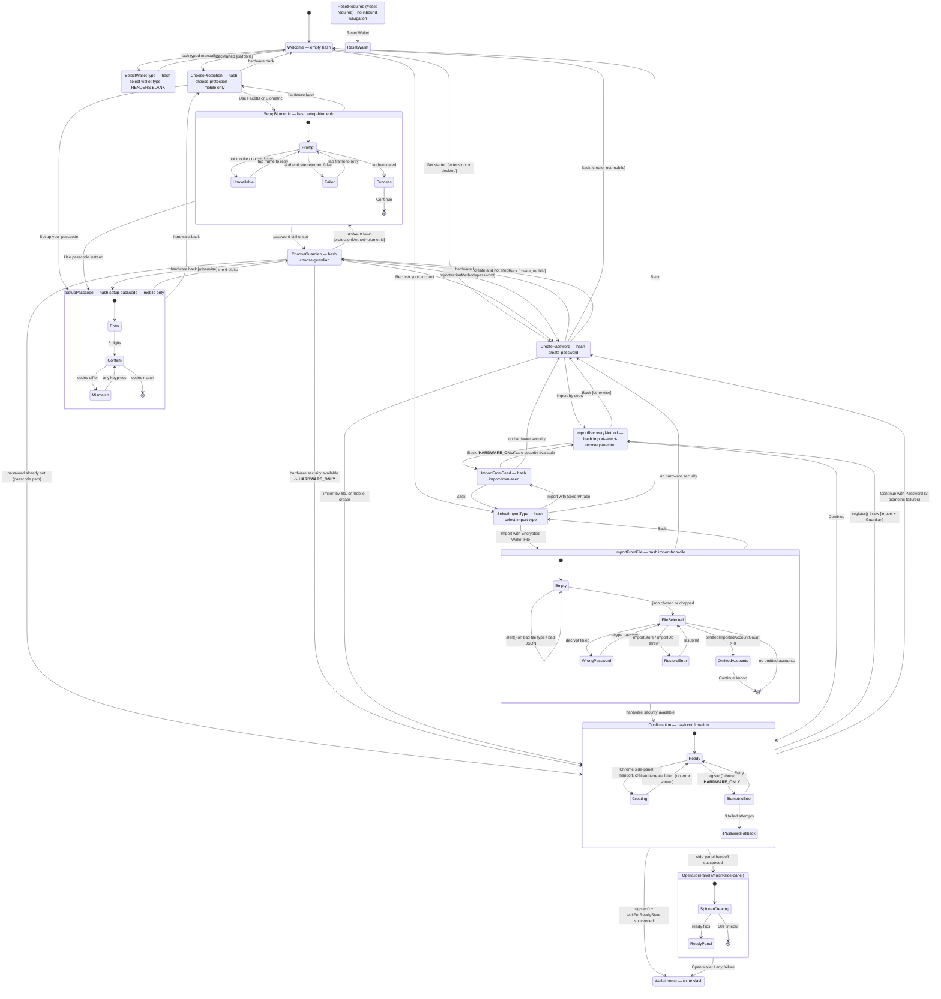

# Onboarding — three-way cross-validation

Three sources, checked against each other:

| Source | What it says exists |
|---|--:|
| **Shipped code** — `src/app/pages/Welcome.tsx` + `src/screens/onboarding/` | 33 distinct states |
| **Design system** — `index.html`, Onboarding flow | 28 screens |
| **E2E harness** — `playwright/e2e/` | 2 screens rendered, **1 interacted with** |

## The harness does not test onboarding

This is the headline, and it means the three-way validation is really two-way.

Every wallet in `playwright/e2e/` — all 21 Chrome call sites, all 7 iOS — is provisioned through
the `__test_skip_onboarding` query-param bypass at `Welcome.tsx:134-178`, which sets seed,
password and wallet type in one effect and jumps to `/#confirmation`. Of 15 onboarding screens,
**two render** (`Welcome`, never interacted with; `Confirmation`) and **one is clicked**
(`onboarding-confirmation-submit`). Six assertions total, none about onboarding UI.

Zero coverage: import-by-file (the screen has no `data-testid` at all), guardian selection,
biometric setup, passcode setup, back-navigation, and `ResetRequired`. Import-by-seed and password
creation exist only in `playwright/tests/popup-smoke.spec.ts`, a different config, whose create-flow
test is `.skip`'d at line 34.

**Selector drift, in live code:** `android-wallet-page.ts:154,172` still looks for "I already have
a wallet" and "Get started" where the UI now says "Recover your account" and "Open wallet". Masked
only because no Android spec calls `importWallet`.

## The user is never shown their recovery phrase

`setStep` has exactly one writer — the hash effect at `Welcome.tsx:465-537` — and it can produce
only 12 of the 17 `OnboardingStep` members. `BackupSeedPhrase`, `VerifySeedPhrase`,
`SelectRecoveryMethod`, `SelectTransactionType` and `BiometricSetup` are never among them. Their
submit callbacks emit action ids that `Welcome.tsx`'s `onAction` does not handle either
(`navigator.tsx:165-183` falls to `default: break` at `:458-459`). Dead twice over.

`ForgotPassword.tsx` is a second consumer of `OnboardingFlow` and *could* reach them, but the ids
that would trigger it — `'create-wallet'`, `'backup-seed-phrase'` — are emitted by nothing.
Verified independently: `grep` finds them only in the type union and the handler cases.

So seed-phrase backup is unreachable in **both** first-run onboarding and the reset flow. It
survives only behind Settings → Recovery phrase and a Home prompt pointing there.

**This is probably deliberate** — Guardian-first recovery is the product strategy, and a
Guardian-recovered wallet does not need the user to write twelve words down on day one. But it has
not been decided anywhere legible, and the leftovers are now causing real bugs. The decision to
make: **is seed-phrase backup part of first run, or is Guardian the only day-one recovery path?**

- If **Guardian only** — delete the four components, the hash cases, `env.ts:121-126`, and retire
  mocks `08 · Back up your wallet` and `09 · Verify seed phrase` (already retagged *unreachable*).
- If **backup returns** — those two mocks are its spec, and the wiring is a few action ids.

## Live user-facing bugs on the recovery path

1. **"Get started" on `/forgot-password` does nothing.** The button emits `'select-wallet-type'`;
   `navigator.tsx:133` rewrites it to `{id:'choose-protection'}`; `ForgotPassword.tsx`'s `onAction`
   has no such case and falls through to `default: break` at `:126-127`. Verified: its cases are
   `create-wallet`, `select-import-type`, `import-from-file`, `import-wallet-file-submit`,
   `import-from-seed`, `import-seed-phrase-submit`, `backup-seed-phrase`, `verify-seed-phrase`,
   `create-password`, `create-password-submit`, `confirmation`, `back`. No `choose-protection`.
   A user who forgot their password and wants a fresh wallet taps a dead button.

2. **`t('importSeedPhraseError')` has no key.** Verified absent from `en.json`. A user who
   mistypes a seed word sees the literal string `importSeedPhraseError` in red
   (`ImportSeedPhrase.tsx:99`). The tests assert on the raw key, so CI passes — and
   `yarn lint:i18n` would not have caught it either, because it lints three `.js` files.

3. **`/#select-wallet-type` renders a blank screen.** Live hash case at `Welcome.tsx:470` sets a
   step `navigator.tsx` has no case for. Still listed in `env.ts:121` as a real onboarding URL.

4. **Failure on Confirmation is silent.** `Welcome.tsx:396-408` handles two error shapes. Extension
   and desktop create, import-by-file, and import-by-seed-as-public all fall through to
   `setIsLoading(false)` — the spinner stops and the screen still reads "Your Wallet is ready!".
   The headline also claims readiness *before* `register()` has run in the classic flow.

5. **Six hardcoded English strings** in the encrypted-file path, including its two likeliest errors
   (`'Wrong password'`, `"Couldn't restore the wallet…"`), plus four `window.alert()` calls that do
   not behave properly in a Capacitor WebView.

## No terms gate, but analytics from the first tap

There is no terms or analytics consent step. The only terms text is passive inline copy on
`CreatePassword` (`:216-226`) — and `CreatePassword` is skipped entirely on the mobile passcode
path and on every hardware-security path, so a user can complete onboarding having never seen it.
`trackEvent` fires on every action from the first tap (`Welcome.tsx:462`).

## Coverage: shipped states vs Crust screens

33 shipped states against 28 mocks. The mocks cover the create path and the extension path well.
The gaps are concentrated in **import-by-file**, which has five distinct states in code
(empty, selected, wrong password, restore error, omitted accounts) and **one** mock, and in the
**biometric sub-states** (prompt, unavailable, failed, success) where Crust has three.

---

<!-- ===== shipped state machine ===== -->

# Bread Wallet — Onboarding State Machine (as shipped)

Read-only analysis of `/Users/bs/Develop/Miden/Projects/worktrees/earn-integration`.
All line references are to that worktree.

## How it actually works (orientation)

Onboarding is **two files cooperating**:

- `src/app/pages/Welcome.tsx` — the state machine. Holds all onboarding state in React
  `useState` (nothing persisted), maps `location.hash` → `OnboardingStep` in one `useEffect`
  (`src/app/pages/Welcome.tsx:465-537`), and handles every `OnboardingAction` in `onAction`
  (`src/app/pages/Welcome.tsx:257-463`). It is mounted by `PageRouter` on the `*` and `/`
  catch-alls when `resolveRootView(ctx) === 'welcome'`
  (`src/app/PageRouter.tsx:94-95`, `src/app/PageRouter.tsx:120-121`).
- `src/screens/onboarding/navigator.tsx` — a **pure `switch (step)` renderer**
  (`src/screens/onboarding/navigator.tsx:204-267`). It owns no routing; it translates each
  screen's callback into an `OnboardingAction` and hands it back up.

`src/screens/onboarding/Welcome.tsx` (named in the brief) does not exist. The two Welcomes are
`src/app/pages/Welcome.tsx` (the state machine) and
`src/screens/onboarding/common/Welcome.tsx:18` (the presentational splash screen).

There is a **second consumer** of the same `OnboardingFlow` component:
`src/app/pages/ForgotPassword/ForgotPassword.tsx:150-157`, which drives `step` with `setStep`
instead of hashes. It is analysed separately below (it changes the unreachability verdict's
shape but not its conclusion).

**Chrome side-panel handoff** is a real fork in the create path:
`canHandoffToSidePanel()` (`src/lib/extension/side-panel-handoff.ts:33-37`) is true only on a
Chrome extension build with `chrome.sidePanel.open`, and false under E2E. When true, the
Confirmation screen auto-creates the wallet on arrival and jumps to the routed
`/finish-side-panel` page (`src/app/pages/Welcome.tsx:231-255`).

---

## State table

Progress values are from `STEP_TO_PROGRESS` (`src/screens/onboarding/navigator.tsx:47-61`).
On the extension/desktop **create** flow the indicator renders 3 segments and every position
shifts down by one (`src/screens/onboarding/navigator.tsx:111-120`).

"Back button" = the generic secondary `Back` button the navigator appends
(`src/screens/onboarding/navigator.tsx:334-343`); it is suppressed for Welcome,
ChooseProtection, SetupPasscode, SetupBiometric, ChooseGuardian and Confirmation.

### 1. Welcome

| Field | Value |
|---|---|
| Hash / step id | `''` → `OnboardingStep.Welcome` (`'welcome'`), `src/app/pages/Welcome.tsx:467-469` |
| Component | `src/screens/onboarding/common/Welcome.tsx:18`, rendered `src/screens/onboarding/navigator.tsx:205-206` |
| Title | `welcome` = "Welcome" + `toLowercase` = "to" + `midenWallet` = "Bread!" (`src/screens/onboarding/common/Welcome.tsx:26-29`) |
| Body | `breadWalletDescription` = "Bread Wallet is a simple and secure way to manage your digital money privately." (`:32`) |
| Actions | `getStarted` = "Get started" (`:36`) → `onSubmit('select-wallet-type')` → navigator maps it to `{id:'choose-protection'}` (`src/screens/onboarding/navigator.tsx:133-137`) → `navigate(protectionStepRoute())` (`src/app/pages/Welcome.tsx:262-268`): mobile `/#choose-protection`, extension/desktop `/#create-password`. — `recoverYourAccount` = "Recover your account" (`:46`, button `id="import-link"`) → `{id:'select-import-type'}` → `/#select-import-type` (`src/app/pages/Welcome.tsx:314-317`) |
| Entry | Default when hash is empty; also every `navigate('/')` from a back/guard branch |
| Exit | The two actions above only |
| Platform gating | `isMobile()` only changes padding (`src/screens/onboarding/common/Welcome.tsx:35`). The *destination* of "Get started" is platform-gated (see Actions) |
| Header / Back | No progress header (`src/screens/onboarding/navigator.tsx:296`), no Back button (`:334`) |
| Hardware back | Handler returns `false` (`src/app/pages/Welcome.tsx:542-544`) → OS handles it (Android minimises) |
| Can render blank | No |

### 2. SelectWalletType — **renders blank**

| Field | Value |
|---|---|
| Hash / step id | `#select-wallet-type` → `OnboardingStep.SelectWalletType`, `src/app/pages/Welcome.tsx:470-473` |
| Component | **None.** `navigator.tsx`'s switch has no `SelectWalletType` case, so it falls to `default: return <></>` (`src/screens/onboarding/navigator.tsx:265-266`) |
| Copy | None |
| Actions | None. Only the appended `Back` button (`back` = "Back") is clickable |
| Entry | Not reachable from any in-app control. Only by typing the hash, or via the extension's own URL list `src/app/env.ts:121` (`onboardingUrls`, used to find an existing onboarding tab) |
| Exit | `back` → `navigate('/')` (`src/app/pages/Welcome.tsx:419-424`) |
| Platform gating | None |
| Header / Back | Header renders with `currentStep = null` → `ProgressIndicator` gets `opacity-0` (`src/screens/onboarding/navigator.tsx:72-76`); Back button renders |
| Hardware back | `back` → `/` |
| Can render blank | **Yes — this is its only rendering.** An invisible progress bar and a Back button on an empty screen |

### 3. ChooseProtection — mobile only

| Field | Value |
|---|---|
| Hash / step id | `#choose-protection` → `OnboardingStep.ChooseProtection`, `src/app/pages/Welcome.tsx:474-484` |
| Component | `src/screens/onboarding/common/ChooseProtection.tsx:13`, rendered `src/screens/onboarding/navigator.tsx:207-208` |
| Title | `chooseHowToProtect` = "Choose how you want to protect your wallet" (`ChooseProtection.tsx:24`) |
| Body | None (illustration only, `ChooseProtection.tsx:22`) |
| Actions | `useFaceIdOrBiometric` = "Use FaceID or Biometric" (`:29`) → `{id:'setup-biometric'}` (`navigator.tsx:196`) → `/#setup-biometric` (`Welcome.tsx:273-276`). — `setUpYourPasscode` = "Set up your passcode" (`:30`, secondary) → `{id:'setup-passcode'}` (`navigator.tsx:197`) → `/#setup-passcode` (`Welcome.tsx:269-272`) |
| Entry | "Get started" on mobile; hardware back from SetupPasscode/SetupBiometric on mobile (`Welcome.tsx:425-428`) |
| Exit | The two actions; back → `/` |
| Platform gating | **Hard guard**: `biometricProtectionSupported()` is `isMobile()` (`Welcome.tsx:55-57`); on extension/desktop the hash effect redirects to `/#create-password` before setting the step (`Welcome.tsx:479-482`). The screen is unreachable off mobile even by direct hash |
| Header / Back | Progress 1/4; **no Back button** (`navigator.tsx:335`) |
| Hardware back | `back` → `navigate('/')` (`Welcome.tsx:419-424`) |
| Can render blank | No |

### 4. SetupPasscode — phase `enter` (mobile only)

| Field | Value |
|---|---|
| Hash / step id | `#setup-passcode` → `OnboardingStep.SetupPasscode`, `src/app/pages/Welcome.tsx:485-494` |
| Component | `src/screens/onboarding/common/SetupPasscode.tsx:16`, rendered `src/screens/onboarding/navigator.tsx:209-215` |
| Title | `setUpYourPasscode` = "Set up your passcode" (`SetupPasscode.tsx:74`) |
| Body | `createA6DigitCode` = "Create a 6 digit code" (`:80`) |
| Actions | `Numpad` digits + delete (`:102`). No button. 6 digits auto-advances after a 150 ms timer (`:44-52`) |
| Entry | ChooseProtection → "Set up your passcode"; SetupBiometric → "Use passcode instead" |
| Exit | 6 digits → phase `confirm` (state 5) |
| Platform gating | **Hard guard**: non-mobile is redirected to `/#create-password` (`Welcome.tsx:489-492`). Passcodes are mobile-only |
| Header / Back | `onPhaseChange` sets `progressOverride = 2` (`navigator.tsx:213`); **no Back button** (`navigator.tsx:336`) |
| Hardware back | `navigate(biometricProtectionSupported() ? '/#choose-protection' : '/')` (`Welcome.tsx:425-428`) — always `/#choose-protection` in practice since the step is mobile-only |
| Can render blank | No |

### 5. SetupPasscode — phase `confirm`

| Field | Value |
|---|---|
| Hash / step id | Same hash `#setup-passcode`; internal `phase` state (`SetupPasscode.tsx:18`) |
| Component | Same file, `:53-65` |
| Title | `confirmYourPasscode` = "Confirm your passcode" (`:74`) |
| Body | `reEnterTheSame6Digits` = "Re-enter the same 6 digits" (`:81`) |
| Actions | Numpad only |
| Entry | 6 digits entered in phase `enter` |
| Exit | Match → `onSubmit(code)` after 150 ms → `{id:'setup-passcode-submit'}` (`navigator.tsx:198`) → `Welcome.tsx:286-296`: generates the mnemonic, sets `password = <the 6 digits>`, `protectionMethod='passcode'`, `navigate('/#choose-guardian')`. Mismatch → state 6 |
| Platform gating | Inherited (mobile only) |
| Header / Back | `progressOverride = 3` (`navigator.tsx:213`) |
| Hardware back | Same as state 4 — exits the whole step, **loses the first-entered code** |
| Can render blank | No |

### 6. SetupPasscode — mismatch

| Field | Value |
|---|---|
| Hash / step id | Same hash; `mismatch` state (`SetupPasscode.tsx:26`, set at `:54-60`) |
| Component | Same file |
| Title | `confirmYourPasscode` (unchanged) |
| Body | `passcodesDoNotMatch` = "Passcodes don't match. Try again." rendered in `text-red-500` (`:76-82`) |
| Actions | Numpad; the first keypress clears the error (`:33`, `:40`) |
| Entry | `confirmCode !== enteredCode` at 6 digits |
| Exit | Only re-entering the confirm code. **There is no path back to phase `enter`** — the user cannot change the passcode they first chose without leaving the step entirely via hardware back |
| Platform gating | Inherited |
| Header / Back | `progressOverride` stays 3 |
| Hardware back | Same as state 4 |
| Can render blank | No |

### 7. SetupBiometric — phase `prompt`

| Field | Value |
|---|---|
| Hash / step id | `#setup-biometric` → `OnboardingStep.SetupBiometric`, `src/app/pages/Welcome.tsx:495-498` |
| Component | `src/screens/onboarding/common/SetupBiometric.tsx:59`, rendered `src/screens/onboarding/navigator.tsx:216-219` |
| Title | `isIOS()` ? `faceIdSetUp` = "Face ID set up" : `biometricSetUp` = "Biometric set up" (`SetupBiometric.tsx:65-67`, rendered `:121`) |
| Body | None in the happy path |
| Actions | Tapping the scan frame retries (`:105-108`, `:116`). `usePasscodeInstead` = "Use passcode instead" (ghost, `:143`) → `{id:'setup-passcode'}` (`navigator.tsx:200`) → `/#setup-passcode` (`Welcome.tsx:269-272`); on extension/desktop the hash effect then bounces on to `/#create-password` (`Welcome.tsx:489-492`) |
| Entry | ChooseProtection → "Use FaceID or Biometric"; hardware back from ChooseGuardian when `protectionMethod === 'biometric'` (`Welcome.tsx:429-432`) |
| Exit | Success → state 10; failure → states 8/9 |
| Platform gating | **This hash has no platform guard** (contrast states 3 and 4). On extension/desktop the step renders and immediately shows the unavailable error (state 8) via `!isMobile()` inside `tryAuthenticate` (`SetupBiometric.tsx:76-79`). `isIOS()` switches the icon and title |
| Header / Back | Progress 2/4; **no Back button** (`navigator.tsx:337`) |
| Hardware back | `navigate(biometricProtectionSupported() ? '/#choose-protection' : '/')` (`Welcome.tsx:425-428`) |
| Can render blank | No — but it renders with *no error and no explanatory body* for the whole duration of the OS prompt, which is fired automatically on mount (`:99-103`) |

### 8. SetupBiometric — unavailable

| Field | Value |
|---|---|
| Hash / step id | Same hash; `error` state (`SetupBiometric.tsx:62`) |
| Component | Same file, error rendered `:122` |
| Body | `biometricUnavailable` = "Biometric unlock isn't available on this device." |
| Triggers | (a) `!isMobile()` (`:76-79`) — extension/desktop; (b) `checkBiometricAvailability()` returns `isAvailable: false` (`:80-84`) — no enrolled biometric / hardware absent |
| Actions | Tap the frame to retry; "Use passcode instead" |
| Exit | Same as state 7 |
| Platform gating | Path (a) is exactly the non-mobile case |
| Can render blank | No |

### 9. SetupBiometric — denied / failed

| Field | Value |
|---|---|
| Hash / step id | Same hash |
| Component | `SetupBiometric.tsx:85-90` |
| Body | `biometricFailed` = "Biometric authentication failed" |
| Trigger | `authenticate(t('biometricSetupReason'))` returns falsy — user cancelled or the OS rejected the scan. The OS prompt string is `biometricSetupReason` = "Set up biometric unlock for your wallet" (`:85`) |
| Actions | Tap the frame to retry (`:105-108`); "Use passcode instead" |
| Notes | A thrown exception from `authenticate` is **not** caught — the `try` has only a `finally` (`:73-93`), so a rejected promise propagates as an unhandled rejection and the screen stays in `prompt` with **no error shown at all** |
| Can render blank | Effectively yes in the throw case: title + frame, no feedback |

### 10. SetupBiometric — success

| Field | Value |
|---|---|
| Hash / step id | Same hash; `phase === 'success'` (`SetupBiometric.tsx:87`) |
| Component | `SetupBiometric.tsx:124-138` |
| Title | `biometricConfirmed` = "Confirmed!" (`:134`) |
| Body | `onlyOneMoreStep` = "Only one more step!" (`:136`) |
| Actions | `continue` = "Continue" (`:145`) → `{id:'setup-biometric-submit'}` (`navigator.tsx:199`) → `Welcome.tsx:277-285`: generates the mnemonic, `protectionMethod='biometric'`, `navigate('/#choose-guardian')`. **No password is set here** — that decision is deferred to `choose-guardian-submit` |
| Can render blank | No |

### 11. ChooseGuardian

| Field | Value |
|---|---|
| Hash / step id | `#choose-guardian` → `OnboardingStep.ChooseGuardian`, `src/app/pages/Welcome.tsx:499-502` |
| Component | `src/screens/onboarding/common/ChooseGuardian.tsx:45`, rendered `src/screens/onboarding/navigator.tsx:220-221` |
| Title | `chooseYourGuardian` = "Choose your Guardian" (`:114`) |
| Body | `chooseGuardianDescription` = "Select an option below" (`:117`); link `learnMoreAboutGuardian` = "Learn more about the Guardian" (`:127`) |
| Cards | One per `getGuardianOptionsForNetwork()` (`:62`). Badge `default` = "Default" (`:156`); captions `guardianOperatedBy` = "Operated by:" and `guardianLocation` = "Location:" (`:165`, `:169`) |
| Actions | Card tap selects (`:142`). `continue` = "Continue" (`:208`) → `{id:'choose-guardian-submit'}` (`navigator.tsx:201-202`) → `Welcome.tsx:297-313` |
| Exit branches | Persists the endpoint to `GUARDIAN_URL_STORAGE_KEY`, sets `walletType = Guardian`; then: **passcode path** (`password` already set) → `/#confirmation`; **biometric path** (`password` null) → `checkHardwareSecurityAvailable()`; hardware present → `password = '__HARDWARE_ONLY__'`, `/#confirmation`; hardware absent → `/#create-password` |
| Custom endpoint | `allowCustomEndpoint` defaults `false` (`ChooseGuardian.tsx:52`) and `navigator.tsx:221` does **not** pass it. The `useCustomGuardianUrl` = "Use a custom Guardian URL" control and its `invalidUrl` validation (`:177-205`, `:93-101`) are **dead in onboarding** — they only light up for `GuardianSettings`. See §3 |
| Platform gating | None on the hash. `checkHardwareSecurityAvailable()` returns `false` unless `isDesktop() \|\| isMobile()` (`Welcome.tsx:27-46`), so the extension always takes the `/#create-password` branch — except the extension never arrives here without a password anyway (see state 13) |
| Header / Back | Progress 3/4; **no Back button** (`navigator.tsx:338`) |
| Hardware back | Branches on `protectionMethod` (`Welcome.tsx:429-436`): `'biometric'` → `/#setup-biometric`; `'password'` → `/#create-password`; else (`'passcode'` or `null`) → `/#setup-passcode`. The `null` fallback sends extension/desktop users to a hash that immediately redirects to `/#create-password` |
| Can render blank | Partially — if `getGuardianOptionsForNetwork()` returns `[]` the grid is empty and Continue no-ops (`:103-105`, early `return`), with no empty-state copy |

### 12. GuardianInfoDrawer (overlay on state 11)

| Field | Value |
|---|---|
| Hash / step id | None — local `isInfoOpen` state (`ChooseGuardian.tsx:55`, opened `:119-128`, rendered `:212`) |
| Component | `src/screens/onboarding/common/GuardianInfoDrawer.tsx:40` |
| Title | `whatIsAGuardian` (`:51`) |
| Body | `guardianInfoDescription` (`<Trans>`, `:57`), then three rows: `guardianInfoWhatItDoesTitle`/`Description`, `guardianInfoSwitchingIsEasyTitle`/`Description`, `guardianInfoWhatItCannotDoTitle`/`Description` (`:69-88`) |
| Actions | `gotIt` (`:94`) → closes. Drawer overlay dismiss also closes |
| Hardware back | **Not registered.** No `useMobileBackHandler` in this file, so on mobile hardware-back falls through to `Welcome.tsx`'s handler and navigates the *step* backwards while the drawer is open |
| Can render blank | No |

### 13. CreatePassword

| Field | Value |
|---|---|
| Hash / step id | `#create-password` → `OnboardingStep.CreatePassword`, `src/app/pages/Welcome.tsx:513-523` |
| Component | `src/screens/onboarding/common/CreatePassword.tsx:87`, rendered `src/screens/onboarding/navigator.tsx:240-241` |
| Title | `createPassword` = "Create password" (`:160`) |
| Body | `createPasswordDescription` = "Set a password to unlock your wallet" (`:161`) |
| Fields | `password` = "Password" label / `enterPassword` = "Enter password" placeholder (`:169-170`); `verifyPassword` = "Verify password" / `enterPasswordAgain` = "Enter password again" (`:186-188`). Eye toggles on both |
| Terms gate | Inline, passive: `byProceeding` = "By proceeding, you agree to the" + `termsOfUsage` = "Terms of Usage" + `andWord` = "and" + `privacyPolicy` = "Privacy Policy" (`:216-226`). **No checkbox, no separate screen** |
| Actions | `continue` = "Continue", disabled unless `isValidPassword` (`:227`, computed `:116-119`: more than one validation check passed **and** the two fields match). Enter key submits (`:142-152`); Tab moves to verify (`:121-126`) |
| Entry | (a) extension/desktop "Get started" (`Welcome.tsx:265-267`); (b) mobile biometric path with no hardware security (`Welcome.tsx:309-311`); (c) import-by-seed with no hardware security (`Welcome.tsx:352-354`); (d) import-by-file with no hardware security (`Welcome.tsx:334-336`); (e) `switch-to-password` after 3 biometric failures (`Welcome.tsx:410-417`); (f) redirect target of `/#choose-protection` and `/#setup-passcode` on non-mobile |
| Exit branches | `{id:'create-password-submit'}` (`navigator.tsx:176-177`) → `Welcome.tsx:357-372`: **create + !isMobile()** → generate mnemonic, `protectionMethod='password'`, `/#choose-guardian`; **import + seed-phrase** → `/#import-select-recovery-method`; **else** (import-by-file, or mobile create) → `/#confirmation` |
| Guard | If `onboardingType === null` (i.e. page reloaded on this hash — all state is in memory) it redirects to `/` rather than dead-ending (`Welcome.tsx:518-521`) |
| Platform gating | `isMobile()` decides the submit branch (`:360`) and the back target (`:442`) |
| Header / Back | Import flow: progress 3/4. Extension/desktop create flow: remapped to the `SetupPasscode` slot then shifted −1 → **1 of 3** (`navigator.tsx:114-120`). Back button **is** rendered (`navigator.tsx:340-342`) |
| Hardware back | `Welcome.tsx:437-447`: create → `isMobile() ? '/#choose-guardian' : '/'`; import-by-file → `/#import-from-file`; else → `/#import-from-seed` |
| Can render blank | No |

### 14. CreatePassword — strength meter sub-states

`PasswordStrengthIndicator`, `src/screens/onboarding/common/CreatePassword.tsx:27-85`. Five
boolean checks (`:106-114`): ≥ `MIN_PASSWORD_LENGTH`, upper+lower mix, letters+digits mix,
special char, ≥ `STRONG_PASSWORD_LENGTH`.

| Checks passed | Copy | Colour |
|---|---|---|
| field empty | `minimumCharsWithAtLeast` = "Minimum 8 characters with at least 1 number" (`:81`) | muted |
| 0–1 | `8chars1number` = "8 characters, 1 number" (`:48`) | `bg-gray-100` |
| 2 | `low` = "Low" (`:46`) | `bg-red-500` |
| 3–4 | `medium` = "Medium" (`:41`) | `bg-yellow-500` |
| 5 | `veryStrong` = "Very strong!" (`:38`) | `bg-green-500` |

Note the submit gate is `> 1` checks (`:117`), so **"Low" (2 checks) is an accepted password**.

### 15. CreatePassword — match confirmation

`itsAMatch` = "It's a match!" in green, shown when `isValidPassword && password === verifyPassword`
(`src/screens/onboarding/common/CreatePassword.tsx:197-204`).

### 16. CreatePassword — mismatch

`passwordsDoNotMatch` = "Passwords do not match" in red, shown when
`verifyPassword.length >= password.length && password !== verifyPassword`
(`src/screens/onboarding/common/CreatePassword.tsx:205-212`).

### 17. SelectImportType

| Field | Value |
|---|---|
| Hash / step id | `#select-import-type` → `OnboardingStep.SelectImportType`, `src/app/pages/Welcome.tsx:503-506` |
| Component | `src/screens/onboarding/import-wallet-flow/SelectImportType.tsx:20`, rendered `src/screens/onboarding/navigator.tsx:234-235` |
| Title | `chooseImportType` = "Choose Your Import Type" (`:46`) |
| Body | `chooseImportTypeDescription` = "Restore public balance with your 12-word phrase. To restore private balance, upload an encrypted backup file." (`:47`) |
| Actions | Card 1: `importWithSeedPhrase` = "Import with Seed Phrase" / `importWithSeedPhraseDescription` (`:27-28`) → `ImportType.SeedPhrase` → `{id:'import-from-seed'}` (`navigator.tsx:149-153`) → `/#import-from-seed` (`Welcome.tsx:339-342`). Card 2: `importWithEncryptedWalletFile` = "Import with Encrypted Wallet File" / `importWithEncryptedWalletFileDescription` (`:31-33`) → `{id:'import-from-file'}` → `/#import-from-file` (`Welcome.tsx:318-321`) |
| Entry | Welcome → "Recover your account"; back from either import screen (`Welcome.tsx:454-456`) |
| Platform gating | None |
| Header / Back | Progress 1/4; Back button rendered |
| Hardware back | `navigate('/')` (`Welcome.tsx:419-424`) |
| Can render blank | No |

### 18. ImportFromSeed

| Field | Value |
|---|---|
| Hash / step id | `#import-from-seed` → `OnboardingStep.ImportFromSeed`, `src/app/pages/Welcome.tsx:507-509` |
| Component | `src/screens/onboarding/import-wallet-flow/ImportSeedPhrase.tsx:21`, rendered `src/screens/onboarding/navigator.tsx:236-237` |
| Title | `importWallet` = "Import Wallet" (`:79`) |
| Body | `enterYourWalletSeedPhrase` = "Enter your wallet's 12-word Seed phrase." (`:80`); `onlyMidenSeedPhrasesAreSupported` = "Only Miden Seed phrases are supported." (`:81`) |
| Fields | 12 numbered inputs (`:83-98`); paste into any field splits on `/[\s,;.\-:/\\_\|]+/` and fills all (`:59-67`) |
| Errors | Unknown word → `t('importSeedPhraseError')` (`:99`) — **this key does not exist in `public/_locales/en/en.json`**, so the literal string `importSeedPhraseError` renders. Checksum failure with all words known → `justValidPreGeneratedMnemonic` = "Just valid pre-generated mnemonic" (`:100`) |
| Actions | `continue` = "Continue", disabled until BIP-39 checksum valid **and** all 12 words in the wordlist (`:47`, `:102-110`) → `{id:'import-seed-phrase-submit'}` (`navigator.tsx:189-190`) |
| Exit branches | `Welcome.tsx:343-356`: hardware security available → `password = '__HARDWARE_ONLY__'`, `/#import-select-recovery-method`; otherwise `/#create-password` |
| Platform gating | Indirect — `checkHardwareSecurityAvailable()` is `false` on the extension (`Welcome.tsx:28-30`), so the extension always goes via CreatePassword |
| Header / Back | Progress 2/4; Back button rendered. Back → `/#select-import-type` (`Welcome.tsx:454-456`) |
| Can render blank | No |

### 19. ImportFromFile — empty

| Field | Value |
|---|---|
| Hash / step id | `#import-from-file` → `OnboardingStep.ImportFromFile`, `src/app/pages/Welcome.tsx:510-512` |
| Component | `src/screens/onboarding/import-wallet-flow/ImportWalletFile.tsx:42`, rendered `src/screens/onboarding/navigator.tsx:238-239` |
| Title | `importWallet` = "Import Wallet" (`:237`) |
| Body | `importWithEncryptedWalletFileDescription` (`:238`) |
| Dropzone | `dragAndDropFile` = "Drag and drop file or" + `chooseFromDevice` = "Choose from device" + `jsonFileType` = ".JSON" (`:256-258`) |
| Errors | Non-`.json` extension → `alert('File type must be .json')` (`:186`); unparseable JSON → `alert('Invalid JSON file')` (`:198`); read error → `alert('Error with file reader')` (`:203`); no file → `alert('Select 1 file')` (`:209`). All four are **hardcoded English via `window.alert`** |
| Actions | Click "Choose from device" or drag-drop |
| Platform gating | None — but drag-and-drop is meaningless on mobile and `window.alert` is unreliable in a Capacitor WebView |
| Header / Back | Progress 2/4; Back button rendered. Back → `/#select-import-type` |
| Can render blank | No |

### 20. ImportFromFile — file selected

| Field | Value |
|---|---|
| Hash / step id | Same hash; `walletFile != null` (`ImportWalletFile.tsx:46`) |
| Component | `ImportWalletFile.tsx:263-304` |
| Body | File chip with filename + clear (X) button (`:264-279`); `enterDecryptionPassword` = "Enter the password you set when exporting your wallet. This will decrypt the file and restore access." (`:284`) |
| Fields | `password` = "Password" label, placeholder `"********"` (hardcoded, `:293`) |
| Actions | `import` = "Import" submit, disabled until form valid + file present (`:319-322`) |
| Exit | Success with no omitted accounts → `onSubmit(seedPhrase, walletAccounts)` (`:148`) → `{id:'import-wallet-file-submit'}` (`navigator.tsx:192-194`) → `Welcome.tsx:322-338`: hardware available → `'__HARDWARE_ONLY__'` + `/#confirmation`; else `/#create-password` |
| Can render blank | No |

### 21. ImportFromFile — wrong password

Same hash. `isWrongPassword` (`ImportWalletFile.tsx:47`) set at `:98` (password-check mismatch)
or `:109` (decrypt threw). Renders `errorCaption='Wrong password'` — **hardcoded English**
(`:296`). Recovery: retype the password.

### 22. ImportFromFile — restore failure

Same hash. `isRestoreError` (`:48`) set at `:151` when the post-decrypt work
(`getMidenClient().client.storeIdentifier()`, `importStore`, `importDb`) throws. Renders
`"Couldn't restore the wallet. Please try again."` — **hardcoded English** (`:298`).
Deliberately distinguished from wrong-password (`:113-118`) so the user isn't trapped retyping a
correct password. Recovery: resubmit, or clear the file (`handleClear`, `:63-71`).

### 23. ImportFromFile — omitted-accounts confirmation

Same hash; `pendingRestore != null` (`ImportWalletFile.tsx:50`, set `:144`). Shows a red panel
with `encryptedFileImportedAccountsOmittedRestoreNotice` interpolating `$importedCount$`
(`:306-312`), the password field is hidden (`:282`), and the submit button relabels to
`continueImport` = "Continue Import" (`:321`). Second click calls `onSubmit` with the already
decrypted payload (`:78-81`).

### 24. ImportSelectRecoveryMethod

| Field | Value |
|---|---|
| Hash / step id | `#import-select-recovery-method` → `OnboardingStep.ImportSelectRecoveryMethod`, `src/app/pages/Welcome.tsx:524-526` |
| Component | `src/screens/onboarding/import-wallet-flow/ImportRecoveryMethod.tsx:21`, rendered `src/screens/onboarding/navigator.tsx:244-250` |
| Title | `importRecoveryMethodTitle` = "How would you like to recover this wallet?" (`:94`) |
| Body | `chooseRecoveryMethodDescription` = "Choose how you want to recover your account if you lose access." (`:95`) |
| Options | `importViaGuardian` = "Import via Guardian" / `importViaGuardianDescription` (`:73-74`), badged `default` = "Default"; `importPublicAccount` = "Import public account" / `importPublicAccountDescription` (`:80-81`) |
| Guardian sub-panel | Preset grid from `getGuardianOptionsForNetwork()` (`:124-142`); `guardianEndpoint` = "Guardian URL" label with the resolved URL (`:145-146`); `useDifferentGuardian` = "Use a different guardian" toggle (`:154`) revealing a free-text `Input` (`:157-167`) |
| Actions | `continue` = "Continue", disabled unless on-chain selected or the sanitized URL passes `isValidGuardianUrl` (`:32-33`, `:177`) → `{id:'import-select-recovery-method'}` (`navigator.tsx:248`) → `Welcome.tsx:373-380`: sets `walletType`, persists the endpoint if Guardian, clears the error, `/#confirmation` |
| Entry | Import-by-seed with hardware security (`Welcome.tsx:351`); CreatePassword submit on the import+seed branch (`Welcome.tsx:368`); **re-entry from a failed Confirmation** (`Welcome.tsx:399-401`) |
| Platform gating | None |
| Header / Back | Progress 4/4; Back button rendered. Back → `password === '__HARDWARE_ONLY__' ? '/#import-from-seed' : '/#create-password'` (`Welcome.tsx:448-453`) |
| Can render blank | This state is reachable **only from the import-by-seed path**. Import-by-file never routes here (`Welcome.tsx:322-338` goes to `/#confirmation` or `/#create-password`, and the CreatePassword branch at `:367` requires `importType === ImportType.SeedPhrase`), so a file import silently keeps the `walletType` default of `Guardian` (`Welcome.tsx:99`) with no user choice |

### 25. ImportSelectRecoveryMethod — guardian lookup failed

Same hash. `guardianLookupError` is set in `Welcome.tsx:399-401` when `register()` throws on an
import with `walletType === Guardian`, and the user is navigated back here. The screen shows
`guardianAccountNotFound` = "We couldn't find your account on this guardian. Check the URL or
import as a public account instead." gated on `isError && !dirty && selected === Guardian`
(`ImportRecoveryMethod.tsx:29`, rendered `:168`) — so **any interaction sets `dirty` and hides
the error** (`:46`, `:51`, `:57`, `:62`, `:164`).

### 26. Confirmation

| Field | Value |
|---|---|
| Hash / step id | `#confirmation` → `OnboardingStep.Confirmation`, `src/app/pages/Welcome.tsx:527-533` |
| Component | `src/screens/onboarding/common/Confirmation.tsx:25`, rendered `src/screens/onboarding/navigator.tsx:253-263` |
| Title | `yourWalletIsReady` = "Your \<highlight\>Wallet\</highlight\> is ready!" via `<Trans>` (`:62`) |
| Body | `recoveryPhraseSevenDayReminder` = "Write down your recovery phrase within 7 days to fully secure your wallet." (`:66`); `recoveryPhraseDailyReminder` = "We'll remind you daily on the home screen." (`:69`) |
| Actions | `openWallet` = "Open wallet" (`:54`, `:105`) → `{id:'confirmation'}` (`navigator.tsx:185`) → `Welcome.tsx:381-409`: `setIsLoading(true)`, `register()`, `waitForReadyState()`, `navigate('/')` |
| Guard | `if (!password) navigate('/')` (`Welcome.tsx:528-529`) — protects against a reload on this hash |
| Failure branches | `Welcome.tsx:396-408`: import + Guardian → `guardianLookupError = true`, back to `/#import-select-recovery-method` (state 25); `password === '__HARDWARE_ONLY__'` → increment `biometricAttempts`, set `biometricError` (state 27). **Any other failure — extension/desktop create, import-by-file, import-by-seed public — sets nothing**: the spinner stops and the screen returns to its "Your Wallet is ready!" state with no error at all |
| Copy accuracy | In the classic flow the wallet does **not** exist when this screen says it is ready — `register()` only runs on the button click |
| Platform gating | The `creating` variant (state 28) is Chrome-extension only |
| Header / Back | Progress 4/4; **no Back button** (`navigator.tsx:339`) |
| Hardware back | Consumed without navigating while `isLoading` (`Welcome.tsx:545-548`). Otherwise `onAction({id:'back'})` runs and **matches no branch** in the back chain (`Welcome.tsx:419-456`) — the press is swallowed and nothing happens |
| Can render blank | No |

### 27. Confirmation — biometric retry / password fallback

Same hash. `biometricAttempts` and `biometricError` come from the `__HARDWARE_ONLY__` failure
branch (`Welcome.tsx:402-407`).

- **Attempts 1–2** (`hasError`, `Confirmation.tsx:38`): `biometricFailed` = "Biometric
  authentication failed" plus `biometricAttemptsRemaining` = "$count$ attempt(s) remaining"
  (`:74-78`). Primary button relabels to `retry` = "Retry" (`:54`).
- **Attempts ≥ 3** (`MAX_BIOMETRIC_ATTEMPTS`, `Confirmation.tsx:9`, `:37`): two buttons —
  `continueWithPassword` = "Continue with Password" (`:89`) → `{id:'switch-to-password'}`
  (`navigator.tsx:187`) → `Welcome.tsx:410-417` clears `password`/attempts/error, sets
  `useBiometric = false`, `navigate('/#create-password')`; and `tryBiometricAgain` = "Try
  Biometric Again" (`:95`) → retries `onSubmit`.

Note `biometricError`'s text is captured (`Welcome.tsx:406`) but never rendered — the screen
always shows the fixed `biometricFailed` string.

### 28. Confirmation — `creating` (Chrome side-panel handoff)

| Field | Value |
|---|---|
| Hash / step id | `#confirmation` with `confirmCreating` true (`Welcome.tsx:569`) |
| Component | `src/screens/onboarding/common/Confirmation.tsx:43-52` — an **early return** that replaces the whole screen |
| Copy | `creatingYourWallet` = "Creating your wallet…" under a `Spinner` |
| Entry | `canHandoffToSidePanel()` (`src/lib/extension/side-panel-handoff.ts:33-37`) **and** step is Confirmation **and** `confirmPhase === 'idle'` **and** `onboardingType === Create` **and** password is set and is not `'__HARDWARE_ONLY__'` (`Welcome.tsx:231-236`) |
| Exit | Success → `navigate('/finish-side-panel')` (`Welcome.tsx:247`) → state 29. Failure → `confirmPhase = 'failed'` (`Welcome.tsx:252`), which drops `creating` back to false and reverts to the classic click-to-create screen (state 26) **with no error message** |
| Platform gating | Chrome extension only; disabled under `MIDEN_E2E_TEST` |
| Hardware back | Not applicable (extension) |
| Can render blank | No, but it is a bare spinner + one line — no progress detail, no cancel |

### 29. OpenSidePanel — creating (routed, `/finish-side-panel`)

| Field | Value |
|---|---|
| Route | `/finish-side-panel`, `src/app/PageRouter.tsx:52`; SKIPs to the `*` catch-all (Unlock) when `ctx.locked` |
| Component | `src/app/pages/OpenSidePanel.tsx:68-72` |
| Copy | `creatingYourWallet` = "Creating your wallet…" under a `Spinner` |
| Actions | None |
| Exit | `ready` flips → state 30. 60 s timeout (`READY_TIMEOUT_MS`, `:17`, `:40-44`) → `navigate('/')` |
| Platform gating | Chrome extension only |
| Can render blank | No, but it is a pure spinner with no cancel and no failure copy |

### 30. OpenSidePanel — ready

| Field | Value |
|---|---|
| Route | Same |
| Component | `src/app/pages/OpenSidePanel.tsx:74-100` |
| Title | `yourWalletIsReady` via `<Trans>` (`:82-86`), `description=""` (`:87`) |
| Actions | `openWallet` = "Open wallet" (`:93`) → `openSidePanelToWallet()` then `closeOnboardingTab()`; on either failure → `navigate('/')` (`:46-62`) |
| Can render blank | No — but the `Message` renders with an empty description, so the layout has a blank body slot |

### 31. ResetRequired (routed, `/reset-required`)

| Field | Value |
|---|---|
| Route | `/reset-required`, `src/app/PageRouter.tsx:53` → `src/app/pages/ResetRequired.tsx:6-11` |
| Component | `src/screens/onboarding/ResetRequired.tsx:15` (exported as `ForgotPasswordInfoScreen` — a copy-paste leftover) |
| Title | `resetRequired` = "Wallet Reset Required" — used both as the `NavigationHeader` title (`:28`) and the `Message` title (`:33`) |
| Body | `resetRequiredDescription` = "Miden Testnet has upgraded to bech32 account IDs to improve your experience. To keep using your wallet, please restore from a backup file or seed phrase, or create a new one." (`:34`); `resetRequiredSecondDescription` = "We're sorry for the inconvenience." (`:37`) |
| Actions | `reset` = "Reset Wallet" (`:41`) → `navigate('/reset-wallet')` (`src/app/pages/ResetRequired.tsx:8`) |
| Entry | Only by navigating to `/reset-required`. **No code in this worktree navigates there** — grep finds the route registration and the page, nothing else |
| Platform gating | None, but the container is a hardcoded `w-[22.5rem] h-[37.5rem] md:w-[37.5rem] md:h-[46.875rem]` fixed box (`:21`) that ignores mobile safe areas and does not fill a phone viewport |
| Hardware back | None registered |
| Can render blank | No |

### 32. ForgotPasswordInfo (routed, `/forgot-password-info`)

Adjacent to onboarding, reached from Unlock (`src/app/pages/Unlock.tsx:202`, `:208`).
Component `src/screens/onboarding/forgot-password-flow/ForgotPasswordInfo.tsx:16`. Copy:
`forgotPassword` (header + title), `forgotPasswordDescription`, `forgotPasswordSecondDescription`.
Actions: `signOut` (`:42`) → `navigate('/forgot-password')` (`src/app/pages/ForgotPassword/ForgotPasswordInfo.tsx:9`);
close (`:29`) → `onForgotPasswordClose`. Same fixed-size container problem as state 31.

### 33. E2E bypass (build-gated, not user reachable)

`src/app/pages/Welcome.tsx:134-187`. Gated on `process.env.MIDEN_E2E_TEST === 'true'`
(`:141`), so it tree-shakes out of production builds. Triggered by
`?__test_skip_onboarding=1` or `window.__TEST_SKIP_ONBOARDING`. Seeds seed phrase +
password + wallet type and jumps straight to `/#confirmation` (`:181-187`).
Listed for completeness; it is not a design surface.

**Total distinct states: 33** — 28 inside the hash machine (states 1–28, one of which is the
Guardian info overlay), 4 routed/adjacent (states 29–32), 1 build-gated E2E bypass (state 33).

---

## Flow diagram

Hashes are written without the leading `#` so the diagram renders (a bare `#` starts an entity
escape in mermaid labels). Read `hash choose-protection` as `/#choose-protection`.

Nodes with **no inbound edge from any in-app control**: `SelectWalletType` (hash only) and
`ResetRequired` (nothing navigates to `/reset-required`).

---

## Unreachable onboarding code

### Verdict on the prior analysis: **I agree — and it is worse than stated**

The claim was that `BackupSeedPhrase`, `VerifySeedPhrase`, `SelectRecoveryMethod` and
`SelectTransactionType` are wired into `navigator.tsx` but unreachable, and that
`/#select-wallet-type` renders a blank fragment. Both parts confirmed. Two additions the prior
analysis missed: these screens are dead in the **second** consumer of `OnboardingFlow` as well,
and the whole "create" branch of the forgot-password flow is dead with it.

**Proof 1 — `step` has exactly one writer.**
`setStep` is called in 12 places, all inside the single hash `useEffect`
(`src/app/pages/Welcome.tsx:465-537`): lines 468, 472, 483, 493, 497, 501, 504, 508, 511, 522,
525, 531. Nothing else in the file mutates `step`. The steps it can produce are:

`Welcome`, `SelectWalletType`, `ChooseProtection`, `SetupPasscode`, `SetupBiometric`,
`ChooseGuardian`, `SelectImportType`, `ImportFromSeed`, `ImportFromFile`, `CreatePassword`,
`ImportSelectRecoveryMethod`, `Confirmation` — 12 of the 17 members of `OnboardingStep`
(`src/screens/onboarding/types.ts:19-37`).

Never produced: `BackupSeedPhrase`, `VerifySeedPhrase`, `SelectRecoveryMethod`,
`SelectTransactionType`, `BiometricSetup`.

**Proof 2 — no hash case exists for them.** The switch has no `#backup-seed-phrase`,
`#verify-seed-phrase`, `#select-recovery-method`, `#select-transaction-type` or
`#biometric-setup` case, and the `default` is a bare `break`
(`src/app/pages/Welcome.tsx:534-535`). Navigating to one of those hashes therefore changes the
URL and leaves `step` at whatever it was — on a cold load, the initial
`useState(OnboardingStep.Welcome)` (`src/app/pages/Welcome.tsx:94`), i.e. the Welcome splash
under a `#verify-seed-phrase` URL.

**Proof 3 — their submit handlers are dead too, independently.** Even if the screens rendered,
their `onSubmit` callbacks emit action ids that `Welcome.tsx`'s `onAction` switch does not
handle, so they hit `default: break` (`src/app/pages/Welcome.tsx:458-459`):

| Emitter | Action emitted | Handled in `Welcome.tsx`? |
|---|---|---|
| `onBackupSeedPhraseSubmit` — `src/screens/onboarding/navigator.tsx:165-168` | `{id:'verify-seed-phrase'}` | No |
| `onVerifySeedPhraseSubmit` — `src/screens/onboarding/navigator.tsx:170-174` | `{id:'create-password', payload: WalletType.OnChain}` | No — only `'create-password-submit'` is handled (`:357`) |
| `onSelectRecoveryMethodSubmit` — `src/screens/onboarding/navigator.tsx:179-180` | `{id:'select-recovery-method'}` | No |
| `onSelectTransactionTypeSubmit` — `src/screens/onboarding/navigator.tsx:182-183` | `{id:'select-transaction-type'}` | No |

**Proof 4 — dead in the second consumer as well.**
`src/app/pages/ForgotPassword/ForgotPassword.tsx` renders the same `OnboardingFlow`
(`:150-157`) and drives `step` with `setStep`, so it *could* reach these screens. It cannot:

- `setStep(OnboardingStep.BackupSeedPhrase)` happens only under
  `case 'create-wallet'` (`ForgotPassword.tsx:63-67`) and `case 'backup-seed-phrase'`
  (`:89-92`). **Neither action id is ever emitted by `navigator.tsx`** — the complete list of
  emitted ids is at `navigator.tsx:134, 139, 151, 156, 167, 172, 177, 180, 183, 185, 187, 190,
  193, 196, 197, 198, 199, 200, 202, 248, 285`, and `'create-wallet'` / `'backup-seed-phrase'`
  appear in none of them.
- `setStep(OnboardingStep.VerifySeedPhrase)` happens only under `case 'verify-seed-phrase'`
  (`ForgotPassword.tsx:93-95`). That id *is* emitted — but only by `BackUpSeedPhraseScreen`
  (`navigator.tsx:167`), which is itself unreachable. Circular dead code.
- `SelectRecoveryMethod` and `SelectTransactionType` have no `setStep` call anywhere in
  `ForgotPassword.tsx` at all.

**Consequence the prior analysis missed:** in the forgot-password flow the WelcomeScreen's
"Get started" button emits `'select-wallet-type'`, which `navigator.tsx:133-137` translates to
`{id:'choose-protection'}` — and `ForgotPassword.tsx`'s `onAction` has **no `'choose-protection'`
case**, so it falls to `default: break` (`:126-127`). **"Get started" on `/forgot-password` is a
completely dead button.** Only "Recover your account" works there. This is a live user-facing
bug, not just dead code.

### Everything unreachable, itemised

| Item | Location | Proof |
|---|---|---|
| `BackUpSeedPhraseScreen` render | `src/screens/onboarding/navigator.tsx:222-223` | Proofs 1–4 |
| `VerifySeedPhraseScreen` render | `src/screens/onboarding/navigator.tsx:224-233` | Proofs 1–4. (The component itself *is* live elsewhere — `src/app/templates/VerifySeedPhraseFlow.tsx:267` reuses it as a post-onboarding prompt) |
| `SelectRecoveryMethodScreen` render | `src/screens/onboarding/navigator.tsx:242-243` | Proofs 1–4. Component `src/screens/onboarding/create-wallet-flow/SelectRecoveryMethod.tsx:24` has **no other consumer** |
| `SelectTransactionTypeScreen` render | `src/screens/onboarding/navigator.tsx:251-252` | Proofs 1–4. Component `src/screens/onboarding/create-wallet-flow/SelectTransactionType.tsx:27` has **no other consumer** |
| `OnboardingStep.SelectWalletType` | `src/screens/onboarding/types.ts:21`; step set at `src/app/pages/Welcome.tsx:472` | Reachable *as a step* only by manually typing `/#select-wallet-type`; no button navigates there (`navigator.tsx:133-137` sends "Get started" to `choose-protection` instead). Renders `default: return <></>` (`navigator.tsx:265-266`). This blank render is explicitly asserted by `src/screens/onboarding/navigator.test.tsx:190-197` |
| `OnboardingStep.BiometricSetup` (`'biometric-setup'`) | `src/screens/onboarding/types.ts:31` | No hash case, no navigator case, no `ForgotPassword` case. Its only appearance outside `types.ts` is as the "unmapped step" fixture in `navigator.test.tsx:191` |
| `BiometricSetupSubmitAction` / `'biometric-setup-submit'` | `src/screens/onboarding/types.ts:54`, `:147-150` | Never emitted, never handled |
| `CreateWalletAction` / `'create-wallet'` | `src/screens/onboarding/types.ts:48`, `:63-65` | Never emitted by `navigator.tsx`; only `ForgotPassword.tsx:63` listens |
| `BackupSeedPhraseAction` / `'backup-seed-phrase'` | `src/screens/onboarding/types.ts:50`, `:105-107` | Same |
| `type OnboardingActionId` | `src/screens/onboarding/types.ts:38-61` | Zero references outside `types.ts` (verified by repo-wide grep) |
| `type OnboardingPlan` | `src/screens/onboarding/types.ts:200-202` | Zero references outside `types.ts`. Carries a `TODO` about replacing the hardcoded paths |
| `Header`'s `onBack` prop | `src/screens/onboarding/navigator.tsx:63-68` | Declared and passed (`:298`) but **not destructured** at `:68` (only `currentStep, totalSteps`). The progress header therefore has no back affordance at all. `onboardingType` is likewise accepted and discarded |
| `OnboardingFlowProps.password` | `src/screens/onboarding/navigator.tsx:34` | Passed at `src/app/pages/Welcome.tsx:561`; never destructured in the component signature (`navigator.tsx:82-96`) |
| `useBiometric` / `isHardwareSecurityAvailable` / `onBiometricChange` prop chain | `src/screens/onboarding/navigator.tsx:35-37, 88-90, 228-230`; sourced `src/app/pages/Welcome.tsx:102-103, 564-565, 570` | Their **only** consumer is `VerifySeedPhraseScreen` (`navigator.tsx:228-230`), which is unreachable. The `checkHardwareSecurityAvailable()` mount effect at `Welcome.tsx:124-128` populates state that nothing reads — the routing decisions call `checkHardwareSecurityAvailable()` freshly each time (`:305`, `:329`, `:347`) |
| `ChooseGuardianScreen`'s `allowCustomEndpoint` (and `currentEndpoint`, `title`, `description`, `submitLabel`, `hideHeader`) | `src/screens/onboarding/common/ChooseGuardian.tsx:34-42, 51-52` | `navigator.tsx:221` passes only `onSubmit`. The custom-URL control (`:177-205`), the `invalidUrl` validation (`:93-101`) and the `currentLabel` = "Current" badge (`:156`) can never appear during onboarding — they exist for `GuardianSettings` |
| `ImportSeedPhraseScreen`'s `isError` prop | `src/screens/onboarding/import-wallet-flow/ImportSeedPhrase.tsx:17`, `:23` | `navigator.tsx:237` passes only `wordslist` and `onSubmit`, so the externally-driven error path is unused |
| `/reset-required` route | `src/app/PageRouter.tsx:53` | Registered, but repo-wide grep finds no `navigate('/reset-required')` and no `<Link to="/reset-required">`. The screen is orphaned |
| `ForgotPassword` "Get started" path | `src/app/pages/ForgotPassword/ForgotPassword.tsx:63-67`, `:89-95`, `:126-127` | See Proof 4 — dead button, dead create branch |

### Cross-check against the design system

`design-system/SCREENS.md:29-62` lists 28 onboarding screens. Three of them correspond to
unreachable code, and one is mislabelled:

- `SCREENS.md:53` — "19 | 08 · Back up your wallet | **shipped — 1/4**". It is not shipped; it
  is unreachable (`navigator.tsx:222-223`).
- `SCREENS.md:54` — "20 | 09 · Verify seed phrase | bug / proposed — was missing". Correct: the
  onboarding render is dead.
- `SCREENS.md:49` — "15 | 06c · Set up account recovery | bug / proposed — was missing".
  Corresponds to `SelectRecoveryMethodScreen`, which is dead.

`SelectTransactionType` has no entry in `SCREENS.md` at all.

---

## States with no visual specification

Ordered roughly by how likely a real user is to hit them.

### 1. `/#select-wallet-type` — a genuinely empty screen

`src/screens/onboarding/navigator.tsx:265-266` returns `<></>`. What renders is: a progress
header whose `ProgressIndicator` is forced to `opacity-0` because `currentProgress` is `null`
(`navigator.tsx:72-76`), an empty flex column, and a full-width secondary "Back" button
(`navigator.tsx:340-342`). There is no title, body, illustration or empty state. Explicitly
asserted as intended behaviour by `src/screens/onboarding/navigator.test.tsx:190-197`.

### 2. Confirmation while `register()` runs — screen lies about its own state

`src/app/pages/Welcome.tsx:386-395` sets `isLoading`, then runs `register()` and
`waitForReadyState()` (up to 10 × 100 ms of polling plus the actual wallet creation,
`Welcome.tsx:72-90`). The only visual change is the button's own spinner
(`Confirmation.tsx:108`). The headline still reads `yourWalletIsReady` = "Your Wallet is
ready!" the entire time. There is no progress copy, no step breakdown, and no cancel.

### 3. Confirmation failure with no matching branch — silent revert

`src/app/pages/Welcome.tsx:396-408` handles exactly two failure shapes (import+Guardian, and
`__HARDWARE_ONLY__`). Every other failure — extension/desktop create, import-by-file,
import-by-seed as a public account — runs `setIsLoading(false)` and nothing else. The spinner
stops, the screen returns to "Your Wallet is ready!", and **no error is shown anywhere**. The
only trace is `console.error` at `:397`.

### 4. Side-panel auto-create failure — silent revert

`src/app/pages/Welcome.tsx:248-253` catches the failure, logs it, and sets
`confirmPhase = 'failed'`. That flips `confirmCreating` false (`:569`), so the spinner is
replaced by the ordinary Confirmation screen with no indication that anything failed.

### 5. SetupBiometric during the OS prompt

`src/screens/onboarding/common/SetupBiometric.tsx:114-123` renders the scan frame, the title,
and nothing else while `authenticate()` is pending. No spinner, no "waiting for Face ID" copy.
Worse: the `try` block has only a `finally`, no `catch` (`:73-93`), so if `authenticate()`
*throws* rather than returning false, `error` is never set — the screen sits in `prompt` with
zero feedback and an unhandled promise rejection.

### 6. `PASSWORD_ERROR_CAPTION` renders nothing

`src/screens/onboarding/import-wallet-flow/ImportWalletFile.tsx:286-288` registers the password
field with `required: PASSWORD_ERROR_CAPTION`. That constant is a sentinel
(`src/app/atoms/FormField.tsx:25`) which `ErrorCaption` deliberately suppresses
(`src/app/atoms/FormField.tsx:323-326` returns `null` for it). The required-field validation
therefore produces **no visible message** — the submit button just stays disabled.

### 7. `OpenSidePanel` — spinner-only state with a silent 60 s bail

`src/app/pages/OpenSidePanel.tsx:68-72` is `Spinner` + `creatingYourWallet`. If Ready never
arrives, `READY_TIMEOUT_MS` fires and `navigate('/')` (`:17`, `:40-44`) — the user is silently
moved elsewhere with no explanation. The ready variant renders `Message` with `description=""`
(`:87`), leaving an empty body slot in the layout.

### 8. `Confirmation` `creating` variant

`src/screens/onboarding/common/Confirmation.tsx:43-52` — a bare `Spinner` plus one line, with
`pt-11.5` and no header, no progress, no cancel. Structurally the same unstyled loading state
as #7.

### 9. `RootSuspenseFallback` — the screen before onboarding

`src/app/PageRouter.tsx:91-92` renders it while the MV3 service worker cold-starts.
`src/app/a11y/RootSuspenseFallback.tsx:26-32` is a centred `Spinner` on `bg-app-bg`, no copy,
no branding, no timeout messaging (the 5 s `DELAY` only forces a re-render).

### 10. ChooseGuardian with an empty provider list

`src/screens/onboarding/common/ChooseGuardian.tsx:132-175` maps over
`getGuardianOptionsForNetwork()`. If that returns `[]` on some network, the grid is empty, there
is no empty-state copy, and "Continue" silently no-ops via the `if (!selected) return;` guard
(`:103-105`).

### 11. Reserved-but-blank strips on CreatePassword

`src/screens/onboarding/common/CreatePassword.tsx:67` (`h-4` strength slot), `:197-204` and
`:205-212` (both `h-4` with `hidden`) reserve vertical space that is empty in the default state.

### 12. Silent state-loss redirects

Reloading on `/#create-password` with `onboardingType === null`
(`src/app/pages/Welcome.tsx:518-521`) or on `/#confirmation` with no `password`
(`:528-529`) redirects to `/` with no message. All onboarding state is in-memory React state
(`:94-111`), so a refresh mid-flow throws away the generated seed phrase and restarts silently.

### 13. Unknown hashes desync URL from screen

`src/app/pages/Welcome.tsx:534-535` is `default: break`. Any unrecognised hash leaves `step`
untouched, so the URL and the rendered screen disagree with no correction.

---

## Hardcoded copy

User-facing strings that bypass `t()` / `<T>`, all in the import-by-file path unless noted.

| String | Location | Notes |
|---|---|---|
| `'File type must be .json'` | `src/screens/onboarding/import-wallet-flow/ImportWalletFile.tsx:186` | Native `window.alert`. Unreliable inside a Capacitor WebView |
| `'Invalid JSON file'` | `src/screens/onboarding/import-wallet-flow/ImportWalletFile.tsx:198` | Native `window.alert` |
| `'Error with file reader'` | `src/screens/onboarding/import-wallet-flow/ImportWalletFile.tsx:203` | Native `window.alert` |
| `'Select 1 file'` | `src/screens/onboarding/import-wallet-flow/ImportWalletFile.tsx:209` | Native `window.alert`; unreachable in practice (the branch requires `files` to be empty after a change event) |
| `'Wrong password'` | `src/screens/onboarding/import-wallet-flow/ImportWalletFile.tsx:296` | The primary error on the encrypted-file path |
| `"Couldn't restore the wallet. Please try again."` | `src/screens/onboarding/import-wallet-flow/ImportWalletFile.tsx:298` | Second-most-likely error on that path |
| `'********'` | `src/screens/onboarding/import-wallet-flow/ImportWalletFile.tsx:293` | Password placeholder |
| `'Biometric authentication failed'` | `src/app/pages/Welcome.tsx:406` | Fallback when the thrown error has no `message`. Stored in `biometricError` — which `Confirmation.tsx` never renders (it always shows `t('biometricFailed')`), so this string is currently invisible |
| `'https://'` | `src/screens/onboarding/common/ChooseGuardian.tsx:195` | Custom-endpoint placeholder; unreachable in onboarding (see §3) |

### Inverse problem: an i18n call with no key

`src/screens/onboarding/import-wallet-flow/ImportSeedPhrase.tsx:99` calls
`t('importSeedPhraseError')`, but **`importSeedPhraseError` does not exist in
`public/_locales/en/en.json`**. i18next falls back to the key, so a user who mistypes a seed
word sees the literal string `importSeedPhraseError` in red. The tests bake this in — they
assert on the raw key text (`src/screens/onboarding/import-wallet-flow/ImportSeedPhrase.test.tsx:147`,
`:178`), so the missing key passes CI. `design-system/SCREENS.md:56` already tracks this frame
as "10e · Invalid seed word | bug / proposed" pointing at `ImportSeedPhrase.tsx:99`.

### Not user-facing (listed to pre-empt false positives)

`console.log` / `console.warn` / `console.error` in `src/app/pages/Welcome.tsx:42, 73-89,
167-169, 183, 201, 251, 397` and `ImportWalletFile.tsx:108, 150` are diagnostic only.
`data-testid` values are not copy.

---

## Platform divergence

`isMobile()` is `isCapacitor()` (`src/lib/platform/index.ts:67-69`) — iOS or Android only.
`isExtension()` checks for `chrome/browser.runtime.id` (`:43-48`). `isDesktop()` is `isTauri()`
(`:88-90`). `isIOS()` is `Capacitor.getPlatform() === 'ios'` (`:53-56`).

The single most consequential switch is `biometricProtectionSupported()`
(`src/app/pages/Welcome.tsx:55-57`), which is just `isMobile()`. It drives
`protectionStepRoute()` (`:64-66`) and therefore the entire shape of the create path.

### Create path — mobile

`Welcome → ChooseProtection → (SetupBiometric | SetupPasscode) → ChooseGuardian →
[CreatePassword if no hardware security] → Confirmation → /`

4 progress segments (`navigator.tsx:119`). Passcode is the vault password, stretched through
PBKDF2 (`Welcome.tsx:286-296`). With Secure Enclave / TEE present the biometric branch sets
`password = '__HARDWARE_ONLY__'` and **skips CreatePassword entirely** (`Welcome.tsx:305-311`).

### Create path — extension / desktop

`Welcome → CreatePassword → ChooseGuardian → Confirmation → /`

3 progress segments; CreatePassword is remapped into the `SetupPasscode` slot and every position
shifts down by one (`navigator.tsx:111-120`), so CreatePassword shows **1 of 3** and
ChooseGuardian **2 of 3**.

`ChooseProtection` and `SetupPasscode` are hard-guarded: direct hash navigation to either is
redirected (`Welcome.tsx:479-482`, `:489-492`). `SetupBiometric` is **not** guarded
(`Welcome.tsx:495-498`) — see the gap below.

Desktop (Tauri) is treated as extension for routing, but `checkHardwareSecurityAvailable()`
does run for it (`Welcome.tsx:27-40` checks `isDesktop()` and calls
`lib/desktop/secure-storage`). Since desktop never reaches ChooseGuardian without a password,
that only matters on the import paths.

### Import path — same shape everywhere, different skips

| Step | Mobile / desktop with hardware security | Extension (never has it) |
|---|---|---|
| Import by seed | `ImportFromSeed → ImportSelectRecoveryMethod → Confirmation`, password skipped (`Welcome.tsx:347-355`) | `ImportFromSeed → CreatePassword → ImportSelectRecoveryMethod → Confirmation` (`:352-354`, `:367-368`) |
| Import by file | `ImportFromFile → Confirmation`, password **and** recovery-method both skipped (`Welcome.tsx:328-337`) | `ImportFromFile → CreatePassword → Confirmation` (`:334-336`, `:369-371`) |

`checkHardwareSecurityAvailable()` short-circuits to `false` unless `isDesktop() || isMobile()`
(`Welcome.tsx:28-30`), so the extension always takes the longer route.

### Screens only ever seen on one platform

| Screen | Platform | Enforced at |
|---|---|---|
| `ChooseProtection` | mobile | `Welcome.tsx:479-482` |
| `SetupPasscode` (all 3 sub-states) | mobile | `Welcome.tsx:489-492` |
| `Confirmation` `creating` variant | Chrome extension | `canHandoffToSidePanel()`, `src/lib/extension/side-panel-handoff.ts:33-37` |
| `OpenSidePanel` (both sub-states) | Chrome extension | `src/app/PageRouter.tsx:52`, `src/app/pages/Welcome.tsx:247` |
| `Confirmation` biometric-error and password-fallback variants | mobile / desktop only in practice — they require `password === '__HARDWARE_ONLY__'` (`Welcome.tsx:402`), which the extension can never set | `Welcome.tsx:27-30` |

### iOS vs Android

The only divergence is `SetupBiometric`'s icon and title: `isIOS()` picks `FaceIcon` +
`faceIdSetUp` = "Face ID set up", otherwise `FingerprintIcon` + `biometricSetUp` = "Biometric
set up" (`src/screens/onboarding/common/SetupBiometric.tsx:65-67`). No other onboarding screen
branches on `isIOS()` or `isAndroid()`.

### Hardware back — mobile only

`useMobileBackHandler` returns immediately unless `isMobile()`
(`src/lib/mobile/useMobileBackHandler.ts:32-34`). Per-step behaviour on mobile
(`src/app/pages/Welcome.tsx:540-552`, back chain `:418-457`):

| Step | Hardware back |
|---|---|
| `Welcome` | Returns `false` → OS handles it (Android minimises the app) |
| `SelectWalletType`, `SelectImportType`, `ChooseProtection` | `navigate('/')` |
| `SetupPasscode`, `SetupBiometric` | `/#choose-protection` on mobile |
| `ChooseGuardian` | `/#setup-biometric` / `/#create-password` / `/#setup-passcode` by `protectionMethod` |
| `CreatePassword` | create → `/#choose-guardian` on mobile, `/` otherwise; import-by-file → `/#import-from-file`; else `/#import-from-seed` |
| `ImportSelectRecoveryMethod` | `/#import-from-seed` if `__HARDWARE_ONLY__`, else `/#create-password` |
| `ImportFromFile`, `ImportFromSeed` | `/#select-import-type` |
| `Confirmation` | Consumed with no navigation while `isLoading`; otherwise `onAction({id:'back'})` **matches no branch** and the press is silently swallowed |

Sub-states are not addressable by back: SetupPasscode's `confirm` phase, SetupBiometric's
`success` phase, ImportWalletFile's `FileSelected` / `OmittedAccounts` phases and the
`GuardianInfoDrawer` overlay all exit the *whole step* on a back press rather than the sub-state.
The `GuardianInfoDrawer` registers no handler of its own
(`src/screens/onboarding/common/GuardianInfoDrawer.tsx` has no `useMobileBackHandler`), so
back navigates the flow while the sheet is open.

### Platform-gating gaps

1. **`#setup-biometric` has no platform guard.** `Welcome.tsx:495-498` sets the step
   unconditionally, unlike `#choose-protection` (`:479-482`) and `#setup-passcode`
   (`:489-492`). On the extension/desktop the screen renders and immediately shows
   `biometricUnavailable` via the `!isMobile()` check inside `tryAuthenticate`
   (`SetupBiometric.tsx:76-79`). Its escape hatch is "Use passcode instead", which navigates to
   `/#setup-passcode` — which then redirects to `/#create-password`. Reachable in practice by
   direct hash navigation or a reload on that hash.
2. **`ChooseGuardian`'s back fallback assumes mobile.** With `protectionMethod === null` (a
   reload on `/#choose-guardian`) back goes to `/#setup-passcode`
   (`Welcome.tsx:434-435`) — a mobile-only hash. On the extension the guard bounces it on to
   `/#create-password`, so it works, but only by accident.
3. **`ResetRequired` and `ForgotPasswordInfo` use fixed pixel frames.**
   `src/screens/onboarding/ResetRequired.tsx:21-26` and
   `src/screens/onboarding/forgot-password-flow/ForgotPasswordInfo.tsx:21-27` both hardcode
   `w-[22.5rem] h-[37.5rem] md:w-[37.5rem] md:h-[46.875rem]`, which neither fills a phone
   viewport nor respects `env(safe-area-inset-*)`. Every other onboarding screen uses the
   navigator's `maxWidth: 420` fluid container (`navigator.tsx:291-292`).
4. **Screen transition animation is mobile-only.** `duration: isMobile() ? 0.2 : 0`
   (`navigator.tsx:316`); the extension and desktop get hard cuts.

---

## Terms and analytics — there is no gate

There is **no terms-acceptance screen and no analytics consent screen** anywhere in onboarding.

- The only terms surface is passive inline text on CreatePassword
  (`src/screens/onboarding/common/CreatePassword.tsx:216-226`): "By proceeding, you agree to
  the Terms of Usage and Privacy Policy", with `target="_blank"` links to `TERMS_OF_USE_URL`
  and `PRIVACY_POLICY_URL`. No checkbox, no blocking.
- Because CreatePassword is **skipped** on the mobile passcode path (`Welcome.tsx:300-302`) and
  on the mobile/desktop hardware-security paths (`:305-308`, `:330-333`, `:348-351`), a user
  can complete onboarding having never seen the terms text at all.
- `trackEvent(action.id, eventCategory, eventProperties)` fires unconditionally at the bottom of
  every `onAction` call (`src/app/pages/Welcome.tsx:462`), before any consent exists. The
  analytics enable/disable setting lives in settings
  (`src/lib/analytics/use-analytics-settings.hook.ts:11`), i.e. post-onboarding.

<!-- ===== e2e coverage ===== -->

# Bread Wallet — what the Playwright harness actually exercises during onboarding

Repo root for every path below: `/Users/bs/Develop/Miden/Projects/worktrees/earn-integration`

**Headline: no blockchain-E2E spec drives the onboarding UI at all.** Every wallet in
`playwright/e2e/` is provisioned through the `__test_skip_onboarding` query-param bypass baked
into `src/app/pages/Welcome.tsx:134-178`, which jumps straight from the Welcome screen to the
Confirmation screen with the seed + password pre-set. The only real onboarding UI driving lives
in `playwright/tests/popup-smoke.spec.ts` (a different config, `playwright.config.ts`), and its
create-flow test is `.skip`'d.

---

## Suites and configs

| Suite | Config | Test dir | Runs in CI |
|---|---|---|---|
| Chrome blockchain E2E | `playwright.e2e.config.ts:4` | `playwright/e2e/tests` (ignores `guardian-*`, `swap/**` — `playwright.e2e.config.ts:10`) | `.github/workflows/e2e-blockchain.yml:119,195` (push to main) |
| Chrome guardian E2E | `playwright.guardian.config.ts` (`testMatch: **/guardian-*.spec.ts`) | same dir | `e2e-blockchain.yml:295,368`; `pr-e2e-local.yml:110` |
| Chrome swap E2E | `playwright.swap.config.ts` | `playwright/e2e/tests/swap` | `pr-e2e-swap.yml:98` |
| Chrome stress | `playwright.stress.config.ts` | `playwright/e2e/stress` | manual |
| iOS simulator E2E | `playwright.ios.config.ts:11` (ignores `guardian-*.ios.spec.ts` — `:14`) | `playwright/e2e/ios/tests` | `e2e-blockchain.yml:567` (macos-26-xlarge) |
| iOS guardian E2E | `playwright.ios.guardian.config.ts` | same dir | not wired into a workflow |
| Android E2E | `playwright.android.config.ts` | `playwright/e2e/android/tests` (1 spec) | not wired into a workflow |
| Extension smoke ("popup-smoke") | `playwright.config.ts:4` | `playwright/tests` | `pr.yml:145`, `ci.yml:74` via `yarn test:e2e` |

Nothing is `.only`'d. Skips/gates:
- `playwright/tests/popup-smoke.spec.ts:6` — whole describe skipped on non-Chromium.
- `playwright/tests/popup-smoke.spec.ts:34` — **`test.skip('onboarding create flow completes and hands off to the side panel')`**. This is the *only* test that ever drove create-by-seed-phrase end to end. Reason given at `:30-33`: the create flow is now Guardian-mandatory, so it needs a live guardian backend.
- Guardian specs are excluded from the default runs by `testIgnore` and need `GUARDIAN_URL` (`playwright/e2e/tests/guardian-send-consume.spec.ts:5`, default `http://localhost:3000`).
- `playwright.e2e.config.ts:18` `maxFailures: 1`, `retries: 0` — the suite stops at the first failure, so later specs may never run.

---

## 1–2. Every step the harness drives during onboarding, in order, with assertions

### Chrome — `createNewWallet()` (the path taken by 20 of 21 Chrome spec call sites)

Spec entry point: `playwright/e2e/tests/wallet-lifecycle.spec.ts:11`; implementation
`playwright/e2e/helpers/wallet-page.ts:251-260` → `createWalletViaBypass`
(`playwright/e2e/helpers/wallet-page.ts:174-244`).

| # | Onboarding step | Driven by | Selector / mechanism | Assertion made | Verdict |
|---|---|---|---|---|---|
| 0 | App boot lands on Welcome **or** already-onboarded home | `playwright/e2e/fixtures/two-wallets.ts:242-246` | `[data-testid="onboarding-welcome"]` **`.or()`** `[data-testid="explore-page"]` | one of the two exists within 90 s (retried 3×, `:229-293`) | **clicked-through-only** — the `.or()` means "Welcome rendered" is never actually asserted |
| 1 | Guardian endpoint choice (guardian variant only) | `playwright/e2e/helpers/wallet-page.ts:183-193` | `chrome.storage.local.set({ guardian_url_setting: url })` — **no UI** | none | **not covered** (store write, not a screen) |
| 2 | Welcome → "Get started" / "Recover your account" | `playwright/e2e/helpers/wallet-page.ts:195-205` | `page.goto(fullpage.html?__test_skip_onboarding=1&password=…[&walletType=guardian][&seed=…])` | none | **bypassed** |
| 3 | Protection choice, passcode, biometric, guardian pick, password entry, seed backup, seed verify | — | — | none | **bypassed** (see §5) |
| 4 | Confirmation screen mounts | `playwright/e2e/helpers/wallet-page.ts:209` | `getByTestId('onboarding-confirmation').waitFor({timeout: 60_000})` | container exists | **covered** (existence only — no assertion on the "Your Wallet is ready!" copy, the recovery-phrase reminders, or the illustration) |
| 5 | Click "Open wallet" → `register()` | `playwright/e2e/helpers/wallet-page.ts:213` | `getByTestId('onboarding-confirmation-submit').click()` | none on the button itself (not checked enabled, not checked for label) | **clicked-through-only** |
| 6 | Wallet reaches Ready | `playwright/e2e/helpers/wallet-page.ts:219-229` | `waitForFunction`: `__TEST_STORE__.getState().currentAccount.publicKey` matches `/^m[a-z]{1,4}1[a-z0-9]+/i` **OR** `[data-testid="explore-page"]` present; 120 s | one of the two | **covered** (weakly — the `OR` means an `explore-page` render with an empty store passes) |
| 6b | Failure diagnostics | `playwright/e2e/helpers/wallet-page.ts:230-240` | dumps first 500 chars of `body` into the thrown error | n/a | — |
| 7 | Read the address | `playwright/e2e/helpers/wallet-page.ts:242` → `getAccountAddress()` `:287-336` | store poll (10 s); DOM fallback navigates `/receive`, waits `[data-testid="receive-page"]`, reads `[data-testid="receive-address-full"]`, then regex-scans the container | throws if nothing bech32-shaped (`:329-333`) | **covered** |
| 8 | Address shape | `playwright/e2e/tests/wallet-lifecycle.spec.ts:13-14` | — | `expect(addressA).toBeTruthy()`; `expect(addressA).toMatch(/^m(tst\|dev)/)` | **covered** |
| 9 | Second wallet is distinct | `playwright/e2e/tests/wallet-lifecycle.spec.ts:17-26` | repeat of 0–8 for wallet B | `expect(addressA).not.toBe(addressB)` | **covered** |

Note: the returned `seedPhrase` is `opts.seed ?? []` (`playwright/e2e/helpers/wallet-page.ts:243`) — for a
created wallet it is **always an empty array**, so nothing downstream can verify the mnemonic.

### Chrome — lock / unlock (the only other onboarding-adjacent flow)

| # | Step | Driven by | Selector | Assertion | Verdict |
|---|---|---|---|---|---|
| 10 | Create wallet | `playwright/e2e/tests/wallet-lifecycle.spec.ts:31` | bypass (steps 0–7 above) | none | bypassed |
| 11 | Lock | `playwright/e2e/tests/wallet-lifecycle.spec.ts:35` → `playwright/e2e/helpers/wallet-page.ts:1194-1205` | `__TEST_INTERCOM__.request({type:'LOCK_REQUEST'})` then `page.reload()` — **no UI, no Settings→Lock button** | none — the locked state is never asserted before unlocking | **not covered** as UI |
| 12 | Unlock screen renders | `playwright/e2e/helpers/wallet-page.ts:1214` | `getByTestId('unlock-password').waitFor({timeout:15_000})` | container exists | **covered** |
| 13 | Enter password | `playwright/e2e/helpers/wallet-page.ts:1216-1217` | `#unlock-password` `.fill()` + `.press('Enter')` | none on the input; no wrong-password / lockout case | **clicked-through-only** |
| 14 | Back on home | `playwright/e2e/helpers/wallet-page.ts:1221` and again `playwright/e2e/tests/wallet-lifecycle.spec.ts:41` | `getByTestId('explore-page')` | `toBeVisible({timeout:30_000})` | **covered** (asserted twice) |

### Chrome — `createGuardianWallet()`

`playwright/e2e/tests/guardian-send-consume.spec.ts:39`, `playwright/e2e/tests/swap/swap-guardian.spec.ts:46`,
`playwright/e2e/stress/stress.spec.ts:110-111`. Identical to steps 0–9 plus the storage write at step 1.
The **only** guardian-specific assertion is on the resulting on-chain account, not on any UI:
`playwright/e2e/tests/guardian-send-consume.spec.ts:70-76` —
`auth.signerCommitments.length === 2` and `auth.procedureThresholds.update_guardian === 2`.
The `onboarding-choose-guardian` screen, the guardian option cards, the "use custom guardian URL" input
(`src/screens/onboarding/common/ChooseGuardian.tsx:96-105,188`) and `GuardianInfoDrawer` are never rendered.

### iOS — `createNewWallet()`

Spec `playwright/e2e/ios/tests/wallet-lifecycle.ios.spec.ts:11`; implementation
`playwright/e2e/ios/helpers/ios-wallet-page.ts:134-136` → `createWalletViaBypass` `:158-210`.

| # | Step | Driven by | Selector / mechanism | Assertion | Verdict |
|---|---|---|---|---|---|
| 0 | Fresh install → Welcome | `playwright/e2e/ios/fixtures/two-simulators.ts:91-114` (terminate → uninstall → install → launch with `MIDEN_E2E_TEST=true`) | — | none | setup |
| 1 | Welcome screen present | `playwright/e2e/ios/helpers/ios-wallet-page.ts:164` | `pollForSelector('[data-testid="onboarding-welcome"]', 30_000)` | throws if absent (`:747`) | **covered** — stricter than Chrome (no `.or()` escape hatch) |
| 2 | Bypass navigation | `playwright/e2e/ios/helpers/ios-wallet-page.ts:171-179` | CDP `location.href = url + ?__test_skip_onboarding=1&password=…[&walletType=guardian][&seed=…]`, then `sleep(2_500)` (`:181`) | none | **bypassed** |
| 3 | Confirmation mounts | `playwright/e2e/ios/helpers/ios-wallet-page.ts:185` | `pollForSelector('[data-testid="onboarding-confirmation"]', 120_000)` | throws if absent | **covered** |
| 4 | Click "Open wallet" | `playwright/e2e/ios/helpers/ios-wallet-page.ts:189` | `click('[data-testid="onboarding-confirmation-submit"]')` — plain `el.click()` (`:74-80`), **not** `clickWhenEnabled` | throws only if the element is missing | **clicked-through-only** (a disabled/loading button silently no-ops here) |
| 5 | Store reaches Ready | `playwright/e2e/ios/helpers/ios-wallet-page.ts:192-198` | `status === 2 \|\| 'Ready'` **and** `!!currentAccount`; 120 s private / 180 s guardian (`:170`) | throws on timeout | **covered** — stricter than Chrome (no `explore-page` fallback, and requires `currentAccount`) |
| 6 | Read address | `playwright/e2e/ios/helpers/ios-wallet-page.ts:200-205` | `currentAccount.publicKey` | explicit `throw` if empty | **covered** |
| 7–8 | Address shape + distinctness | `playwright/e2e/ios/tests/wallet-lifecycle.ios.spec.ts:13-14,20-21,25` | — | same three `expect`s as Chrome | **covered** |

### iOS — lock / unlock

| # | Step | Driven by | Selector | Assertion | Verdict |
|---|---|---|---|---|---|
| 9 | Lock | `playwright/e2e/ios/tests/wallet-lifecycle.ios.spec.ts:35` → `playwright/e2e/ios/helpers/ios-wallet-page.ts:600-614` | fire-and-forget `LOCK_REQUEST` + `location.reload()` | none | not covered as UI |
| 10 | Numpad present? | `playwright/e2e/ios/helpers/ios-wallet-page.ts:636-639` | `pollForSelector('[data-testid="unlock-passcode"]', 10_000)`, **`.catch(() => false)`** | none — absence is swallowed | **clicked-through-only** |
| 11 | Tap 6 digits | `playwright/e2e/ios/helpers/ios-wallet-page.ts:641-644` | `[data-testid="numpad-${ch}"]` ×6, 150 ms apart | none per digit | **clicked-through-only** |
| 12 | Home reached | `playwright/e2e/ios/helpers/ios-wallet-page.ts:646-653` | `explore-page` present **OR** store `publicKey` bech32 | throws on timeout | **covered** |
| 13 | Fallback branch | `playwright/e2e/ios/helpers/ios-wallet-page.ts:659-661` | `fillInputAny(['input[type="password"]','input'])` + `clickByText('button', /unlock\|continue\|submit/i)`, both `.catch(() => {})` | **none — this branch can no-op entirely and still "pass"** | **not covered** |
| 14 | Spec-level re-check | `playwright/e2e/ios/tests/wallet-lifecycle.ios.spec.ts:42-46` | `expect.poll(locatorText('[data-testid="explore-page"]') !== null)` | `.toBe(true)` | **covered** |

`playwright/e2e/ios/helpers/ios-wallet-page.ts:626-629` carries an explicit in-code caveat:
*"the numpad-vs-biometric branching on iOS is unverified here."*

---

## 3. Onboarding branches and their coverage

| Branch | Screens | Coverage |
|---|---|---|
| **Create — private (OffChain)** | Welcome → ChooseProtection → SetupPasscode/SetupBiometric → ChooseGuardian → CreatePassword → Confirmation | **Bypassed.** Only Confirmation is touched. `walletType` is forced to `OffChain` at `src/app/pages/Welcome.tsx:154` |
| **Create — Guardian** | + ChooseGuardian option cards / custom URL | **Bypassed.** Endpoint injected into `chrome.storage.local` (`playwright/e2e/helpers/wallet-page.ts:189-192`) or left at the network default on iOS (`playwright/e2e/ios/helpers/ios-wallet-page.ts:175`). Only the resulting on-chain auth structure is asserted (`playwright/e2e/tests/guardian-send-consume.spec.ts:70-76`) |
| **Import — seed phrase** | Welcome → SelectImportType → ImportSeedPhrase → CreatePassword → ImportRecoveryMethod → Confirmation | **Real UI, smoke suite only:** `playwright/tests/popup-smoke.spec.ts:100-143` (happy path) and `:146-178` (validation). Zero blockchain-E2E coverage — `importWallet()` exists on both POMs (`playwright/e2e/helpers/wallet-page.ts:265-268`, `playwright/e2e/ios/helpers/ios-wallet-page.ts:219-222`) and **is never called by any spec**; both route through the same bypass anyway |
| **Import — encrypted wallet file** | SelectImportType → ImportWalletFile | **Zero coverage.** `src/screens/onboarding/import-wallet-flow/ImportWalletFile.tsx` has **no `data-testid` at all**; the file input is `display:none` (`:260`) |
| **Guardian selection UI** | ChooseGuardian + GuardianInfoDrawer | **Zero coverage** |
| **Biometric setup** | SetupBiometric (`src/screens/onboarding/common/SetupBiometric.tsx:111`) | **Zero coverage.** Mobile-only (`src/app/pages/Welcome.tsx:55-57`); the bypass never sets `password='__HARDWARE_ONLY__'`, so the hardware path in `register()` (`src/app/pages/Welcome.tsx:193`) and the biometric retry/`switch-to-password` branches (`:399-417`) are dead in test |
| **Passcode setup** | SetupPasscode (`src/screens/onboarding/common/SetupPasscode.tsx:70`) | **Zero coverage at onboarding.** The numpad *component* is only ever exercised at unlock (`playwright/e2e/ios/helpers/ios-wallet-page.ts:641-644`), and even there without assertions |
| **Password creation** | CreatePassword | **Smoke suite only** (`playwright/tests/popup-smoke.spec.ts:127-129`, via `input[placeholder="Enter password"]`). Strength meter, mismatch state, ToS links — none asserted |
| **Import recovery method** | ImportRecoveryMethod | **Smoke suite only** (`playwright/tests/popup-smoke.spec.ts:132-134`), and only the "Import public account" option; `importViaGuardian` + `guardianAccountNotFound` error state (`src/screens/onboarding/import-wallet-flow/ImportRecoveryMethod.tsx:73-74,168`) are untested |
| **Side-panel handoff** | `/finish-side-panel` → `OpenSidePanel` | **Zero coverage.** Disabled under E2E by `src/lib/extension/side-panel-handoff.ts:34` (`if (process.env.MIDEN_E2E_TEST === 'true') return false;`), and the only test for it is the `.skip`'d `playwright/tests/popup-smoke.spec.ts:34` |
| **Onboarding back navigation** | `onAction({id:'back'})` (`src/app/pages/Welcome.tsx:418-457`), mobile hardware back (`:540-552`) | **Zero coverage** |
| **ResetRequired** | `src/screens/onboarding/ResetRequired.tsx` | **Zero coverage** |

---

## 4. Screens the harness never reaches

Onboarding renders 15 step cases (`src/screens/onboarding/navigator.tsx:204-267`). The blockchain
harness renders exactly **two**: `Welcome` (rendered on boot, never interacted with) and
`Confirmation` (waited for + one click).

**Skipped by the `__test_skip_onboarding` bypass** — the effect at `src/app/pages/Welcome.tsx:134-178`
sets `walletType`, `seedPhrase`, `password`, `onboardingType` in one shot and the follow-up effect
`:181-187` calls `navigate('/#confirmation')`, so every intermediate hash is never visited:

- `ChooseProtection` — `src/screens/onboarding/common/ChooseProtection.tsx:19` (`onboarding-choose-protection`)
- `SetupPasscode` — `src/screens/onboarding/common/SetupPasscode.tsx:70` (`onboarding-setup-passcode`)
- `SetupBiometric` — `src/screens/onboarding/common/SetupBiometric.tsx:111` (`onboarding-setup-biometric`)
- `ChooseGuardian` — `src/screens/onboarding/common/ChooseGuardian.tsx:109` (`onboarding-choose-guardian`)
- `CreatePassword` — `src/screens/onboarding/common/CreatePassword.tsx` (no testid)
- `SelectImportType` — `src/screens/onboarding/import-wallet-flow/SelectImportType.tsx:43` (`import-select-type`)
- `ImportSeedPhrase` — `src/screens/onboarding/import-wallet-flow/ImportSeedPhrase.tsx:77` (`import-seed-phrase`)
- `ImportWalletFile` — `src/screens/onboarding/import-wallet-flow/ImportWalletFile.tsx` (no testid)
- `ImportRecoveryMethod` — `src/screens/onboarding/import-wallet-flow/ImportRecoveryMethod.tsx:91` (`import-recovery-method`)

**Platform-gated (extension/desktop can never render them):**
`ChooseProtection` and `SetupPasscode` — `src/app/pages/Welcome.tsx:55-57,64-66,479-482,489-492`
redirect to `/#create-password` when `!isMobile()`. So even a hypothetical Chrome onboarding spec
could not cover them.

**Dead in the product, not just untested** — these four are wired into `navigator.tsx` but the hash
router at `src/app/pages/Welcome.tsx:465-537` handles no case for them and no `onAction` branch
navigates to them (`:257-460`), so they are currently unreachable by any user:

- `BackupSeedPhrase` — `src/screens/onboarding/navigator.tsx:222-223`
- `VerifySeedPhrase` — `src/screens/onboarding/navigator.tsx:224-233` (renders `data-testid="verify-seed-phrase"`, `src/screens/onboarding/create-wallet-flow/VerifySeedPhrase.tsx:71`)
- `SelectRecoveryMethod` — `src/screens/onboarding/navigator.tsx:242-243`
- `SelectTransactionType` — `src/screens/onboarding/navigator.tsx:251-252`

Related: `OnboardingStep.SelectWalletType` *is* reachable by hash (`src/app/pages/Welcome.tsx:470-473`)
but `navigator.tsx` has no case for it, so `/#select-wallet-type` renders a blank `<></>`
(`src/screens/onboarding/navigator.tsx:265-266`).

**Never reached because the harness disables it:** `/finish-side-panel` / `OpenSidePanel`
(`src/app/PageRouter.tsx:52`) — gated off by `src/lib/extension/side-panel-handoff.ts:34`.

**Post-onboarding side effect never asserted:** `seedWalletPrompt(WalletPromptType.VerifySeedPhrase)`
at `src/app/pages/Welcome.tsx:197` runs on every created wallet; no spec checks the prompt appears.

---

## 5. Test-only bypasses

### A. `__test_skip_onboarding` (the big one)

- **Definition:** `src/app/pages/Welcome.tsx:134-178`. Gated on `process.env.MIDEN_E2E_TEST === 'true'` (`:141`) so it tree-shakes out of production builds.
- **Triggers:** query param `?__test_skip_onboarding=1` (`:143`) or global `window.__TEST_SKIP_ONBOARDING === true` (`:144`).
- **Params consumed:** `walletType` (`:154`, anything but `guardian` → `OffChain` — note this deliberately overrides the component default of `Guardian` at `:99`), `seed` (`:159-165`, space/comma separated → `OnboardingType.Import`), `password` (`:171`, default `'password1'`). Absent `seed` → `generateMnemonic(128)` (`:170`) and `OnboardingType.Create`.
- **What it skips:** everything between Welcome and Confirmation — the protection choice, passcode entry, biometric enrollment, guardian selection, password creation and confirmation, the import-type picker, the 12-word seed grid, the wallet-file upload, and the import recovery-method picker. It lands the user on `/#confirmation` with state already committed.
- **Callers:** Chrome `playwright/e2e/helpers/wallet-page.ts:196-205`; iOS `playwright/e2e/ios/helpers/ios-wallet-page.ts:171-179`; Android `playwright/e2e/android/helpers/android-wallet-page.ts:112-118`.
- **Consequence:** `register()` (`src/app/pages/Welcome.tsx:189-219`) is still real — the vault, the account and the guardian co-signing all happen for real. Only the UI is skipped.

### B. `__TEST_STORE__` — direct Zustand read (and write)

Exposed under `MIDEN_E2E_TEST` (see `CLAUDE.md` "E2E test hooks"). Used as the primary
address source instead of the UI at `playwright/e2e/helpers/wallet-page.ts:293-304` and
`playwright/e2e/ios/helpers/ios-wallet-page.ts:238-246`, and as the readiness gate at
`playwright/e2e/helpers/wallet-page.ts:219-229` / `playwright/e2e/ios/helpers/ios-wallet-page.ts:192-198`.
It is also **written** to — `store.setState({assetsMetadata})` at
`playwright/e2e/helpers/wallet-page.ts:761` and `playwright/e2e/ios/helpers/ios-wallet-page.ts:467`
(claim path, not onboarding).

### C. `__TEST_INTERCOM__` — bypasses the Lock UI entirely

`playwright/e2e/helpers/wallet-page.ts:1195-1200` and `playwright/e2e/ios/helpers/ios-wallet-page.ts:604-608`
send `LOCK_REQUEST` directly. **No Settings → Lock button is ever clicked**, so the lock affordance in
the product is untested; only the unlock screen is reached.

### D. Chrome guardian endpoint seeded into storage

`playwright/e2e/helpers/wallet-page.ts:189-192` writes `guardian_url_setting` to
`chrome.storage.local` before the bypass navigation, explicitly because "the bypass create flow has no
custom-URL field" (`:156-158`). This skips the whole `ChooseGuardian` screen including its custom-URL
validation (`src/screens/onboarding/common/ChooseGuardian.tsx:96-100`).

### E. iOS fixture starts from a genuinely clean install

`playwright/e2e/ios/fixtures/two-simulators.ts:102-114` does terminate → `simctl uninstall` →
install → launch. The comment at `:94-101` explains why a file-level wipe is not enough. This is
**not** a bypass — it is the one place the harness guarantees onboarding state is real.

### F. Other test hooks touched near onboarding

`__TEST_SET_SHARE_PRIVATELY__` (`playwright/e2e/helpers/wallet-page.ts:1082-1095`),
`__TEST_GUARDIAN_AUTH__` / `__TEST_GUARDIAN_AUTH_STRUCTURE__`
(`playwright/e2e/helpers/wallet-page.ts:458-472`, `playwright/e2e/ios/helpers/ios-wallet-page.ts:708-720`),
`__TEST_HEX_TO_BECH32_FAUCET__` (`playwright/e2e/ios/helpers/ios-wallet-page.ts:451`),
`__TEST_TRIGGER_NAVBAR_ACTION__` (per `CLAUDE.md`). None are onboarding-specific.

---

## 6. Selector drift

### Selectors used by specs that do NOT resolve in `src/`

| Selector | Used at | Reality in `src/` | Impact |
|---|---|---|---|
| `getByRole('button', { name: /create a new wallet/i })` | `playwright/tests/popup-smoke.spec.ts:48` | The Welcome CTA is `t('getStarted')` = **"Get started"** (`src/screens/onboarding/common/Welcome.tsx:36`). `createANewWallet` still exists as a locale key but is not rendered by that screen | Would fail — masked because the test is `.skip`'d (`:34`) |
| `getByText(/back up your wallet/i)` + `getByRole('button', {name:/show/i})` + `article > label > label > p:last-child` | `playwright/tests/popup-smoke.spec.ts:50-58` | `BackUpSeedPhrase` is **unreachable** — no hash case in `src/app/pages/Welcome.tsx:465-537` | Dead; `.skip`'d |
| `getByTestId('verify-seed-phrase')` | `playwright/tests/popup-smoke.spec.ts:68,71` | testid exists (`src/screens/onboarding/create-wallet-flow/VerifySeedPhrase.tsx:71`) but the **screen is unreachable** | Dead; `.skip`'d |
| `getByRole('heading', {name:/set up account recovery/i})` + `getByText(/fully private/i)` | `playwright/tests/popup-smoke.spec.ts:84-85` | `SelectRecoveryMethod` is unreachable (`src/screens/onboarding/navigator.tsx:242-243`, no hash case); the create flow now routes to `ChooseGuardian` (`src/app/pages/Welcome.tsx:360-366`) | Dead; `.skip`'d |
| `getByText(/your wallet is ready/i)` / `getByRole('button',{name:/open wallet/i})` | `playwright/tests/popup-smoke.spec.ts:96-97` | Copy is split by `<Trans>` (`src/screens/onboarding/common/Confirmation.tsx:62`) — the sibling test at `:136-138` already documents this and switched to the testid | Fragile; `.skip`'d |
| `clickByText('button', /i already have a wallet/i)` | `playwright/e2e/android/helpers/android-wallet-page.ts:154` | The import link renders `t('recoverYourAccount')` = **"Recover your account"** (`src/screens/onboarding/common/Welcome.tsx:46`) | **Would throw** (`clickByText` throws on no match) — masked only because no Android spec calls `importWallet` |
| `clickByText('button', /get started/i)` after Confirmation | `playwright/e2e/android/helpers/android-wallet-page.ts:172` | Confirmation's CTA is `t('openWallet')` = **"Open wallet"** (`src/screens/onboarding/common/Confirmation.tsx:54,105`) | Same — dead code path |
| `/your wallet is ready/i` on `document.body` | `playwright/e2e/android/helpers/android-wallet-page.ts:169` | Rendered via `<Trans>` with a `<highlight>` span (`src/screens/onboarding/common/Confirmation.tsx:62`), so `textContent` is `"Your Wallet is ready!"` — matches by luck, not by contract | Fragile |
| `pollForCondition(/get started/i button)` after the bypass | `playwright/e2e/android/helpers/android-wallet-page.ts:121-131` | Matches the **Welcome** screen's own "Get started" button, not the Confirmation CTA. Because the bypass reload re-renders Welcome before `navigate('/#confirmation')` fires (`src/app/pages/Welcome.tsx:181-187`), this can click "Get started" and drop into `choose-protection` instead of confirming | **Race / wrong element.** Chrome and iOS both use `onboarding-confirmation-submit` here; Android is the odd one out |
| `getByText(/your address/i)` | `playwright/tests/popup-smoke.spec.ts:215` | Explicitly called out as gone in `playwright/e2e/helpers/wallet-page.ts:280-282` ("no such label exists in the current UI") | Guarded by an `if (receiveVisible)` branch so it usually short-circuits |

Selectors that **do** resolve, verified: `onboarding-welcome` (`src/screens/onboarding/common/Welcome.tsx:21`),
`#import-link` (`:38`), `import-select-type` (`src/screens/onboarding/import-wallet-flow/SelectImportType.tsx:43`),
`import-seed-phrase` + `#seed-phrase-input-N` (`src/screens/onboarding/import-wallet-flow/ImportSeedPhrase.tsx:77,86`),
`import-recovery-method` (`src/screens/onboarding/import-wallet-flow/ImportRecoveryMethod.tsx:91`),
`onboarding-confirmation` / `onboarding-confirmation-submit` (`src/screens/onboarding/common/Confirmation.tsx:57,109`),
`unlock-password` / `#unlock-password` (`src/app/pages/Unlock.tsx:302,316`),
`unlock-passcode` (`:360`), `numpad-N` (`src/components/Numpad.tsx:37,43`),
`explore-page` (`src/app/pages/Explore.tsx:139`),
`receive-page` / `receive-address-full` (`src/app/pages/Receive/AddressTab.tsx:88,94`),
`Enter password` / `Enter password again` placeholders (`src/screens/onboarding/common/CreatePassword.tsx:170,188`).

### Selectors declared in `src/**/*.selectors.ts` that no spec uses

**All 10 files. Every enum member. Zero Playwright references** — `grep -rn "Selectors\." playwright/`
returns nothing. These are **analytics** identifiers fed to `trackEvent`, not DOM hooks
(`src/app/atoms/FormSubmitButton.tsx:36`, `src/app/atoms/CopyButton.tsx:58`), and only two of them
are ever rendered as `data-testid` at all.

| File | Members | Rendered as `data-testid` anywhere? | Used by any spec? |
|---|---|---|---|
| `src/app/ConfirmPage.selectors.ts` (28 members) | ConnectAction, SignAction, TransactionAction, ConsumeAction, … | via `ConfirmPage.tsx` | No |
| `src/app/pages/Settings.selectors.ts` (19) | RevealSeedPhraseButton, RevealHotKeyButton, RemoveAccountButton, … | via `Settings.tsx` | No |
| `src/app/pages/Explore.selectors.ts` (14) | ReceiveButton, SendButton, SwapButton, StakeButton, AssetsTab, … | **Only `CancelTransaction`** (`src/app/templates/history/HistoryItem.tsx:92`). The other 13 are referenced nowhere outside the enum + its unit test | No |
| `src/app/templates/SendForm.selectors.ts` (12) | AmountInput, RecipientInput, SendButton, ConfirmButton, … | **Only `ContactItemButton`** (`src/app/templates/SendForm/ContactsDropdownItem.tsx:36`) | No |
| `src/app/templates/GeneralSettings.selectors.ts` (12) | BiometricToggle, DelegateToggle, AutoConsumeToggle, … | via `GeneralSettings.tsx` / `DAppDrawerSettings.tsx` | No |
| `src/app/templates/InternalConfirmation.selectors.ts` (6) | PreviewTab, RawTab, ConfirmButton, … | **Nowhere** — only its own `.selectors.test.ts` | No |
| `src/app/templates/AdvancedSettings.selectors.ts` (1) | ResyncButton | **Nowhere** — only its own `.selectors.test.ts` | No |
| `src/app/layouts/PageLayout.selectors.ts` (1) | BackButton | via `PageLayout.tsx` | No |
| `src/app/layouts/PageLayout/ChangelogOverlay/ChangelogOverlay.selectors.ts` (2) | Continue, Skip | via `ChangelogOverlay.tsx` | No |
| `src/app/atoms/OpenInExplorerChip.selectors.ts` (1) | ViewOnBlockExplorerLink | via `OpenInExplorerChip.tsx` | No |

**No `*.selectors.ts` file covers onboarding at all** — every onboarding hook is an inline
`data-testid` string. So there is no "screens the harness believes exist" signal from these files
for onboarding; the equivalent signal is the four dead screens listed in §4.

Separate observation worth flagging: `src/app/templates/AdvancedSettings.selectors.ts` and
`src/app/templates/InternalConfirmation.selectors.ts` are entirely unreferenced by product code —
their only consumers are their own unit tests, which assert the enum equals itself.

---

## 7. Chrome vs iOS divergence (same flow)

| Aspect | Chrome (`playwright/e2e/helpers/wallet-page.ts`) | iOS (`playwright/e2e/ios/helpers/ios-wallet-page.ts`) |
|---|---|---|
| Welcome-screen precondition | `onboarding-welcome` **`.or()`** `explore-page`, 3 retries with page reloads (`fixtures/two-wallets.ts:242-292`) — Welcome is never actually required | Hard `pollForSelector('[data-testid="onboarding-welcome"]', 30_000)` (`:164`) — throws if absent |
| Bypass navigation | `page.goto(fullpage.html?...)` (`:205`) | CDP `location.href = …` + fixed `sleep(2_500)` (`:177,181`) |
| Confirmation wait | 60 s (`:209`) | 120 s (`:185`) |
| "Open wallet" click | Playwright `.click()` — auto-waits for actionability (`:213`) | Raw `el.click()` (`:189` → `:74-80`) — **silently no-ops on a disabled button**; `clickWhenEnabled` exists (`:90-103`) but is not used here |
| Readiness gate | `publicKey` bech32 **OR** `explore-page` present, 120 s fixed (`:219-229`) | `status === Ready` **AND** `currentAccount`, 120 s private / **180 s guardian** (`:170,192-198`) — strictly stronger |
| Address extraction | store poll → `/receive` DOM fallback → regex scan → throw (`:287-336`) | store read → throw if empty (`:200-205`). The `/receive` fallback exists (`:234-266`) but is only used by `getAccountAddress()`, not by the create path |
| Guardian endpoint | Written to `chrome.storage.local['guardian_url_setting']` before the bypass, so specs can point at a locally-spawned guardian (`:183-193`, `GUARDIAN_URL` env) | **No storage write** — uses the network default (devnet → guardian-stg), per `:141-146` and `playwright.ios.guardian.config.ts` comment. iOS cannot target a local guardian |
| Guardian auth read | Async `__TEST_GUARDIAN_AUTH__` hook (`:458-472`) | Sync `__TEST_GUARDIAN_AUTH_STRUCTURE__` stash + 30 s poll (`:703-728`) — the long comment at `:670-701` explains the RWI `execute_async_script` callback bug that forced this |
| Lock | `await intercom.request(LOCK_REQUEST)` then reload (`:1194-1205`) | fire-and-forget (no `await`) then reload (`:604-613`) |
| Unlock surface | Password form: `unlock-password` container + `#unlock-password` input + Enter (`:1212-1222`). Platform-forced by `src/app/pages/Unlock.tsx:294` | 6-digit numpad: `unlock-passcode` + `numpad-${digit}` ×6 (`:636-644`), with an unasserted text-input fallback (`:659-661`) |
| Unlock success assert | `getByTestId('explore-page').waitFor` in the helper **and** `expect(...).toBeVisible()` in the spec (`tests/wallet-lifecycle.spec.ts:41`) | `pollForCondition(explore-page ‖ publicKey)` in the helper **and** `expect.poll(locatorText(...) !== null)` in the spec (`ios/tests/wallet-lifecycle.ios.spec.ts:42-46`) |
| `importWallet` | Routes through the same bypass (`:265-268`) | Routes through the same bypass (`:219-222`) — the docstring at `:213-218` says so explicitly ("no spec currently drives this") |
| Spec parity | 9 specs + 7 swap + stress | 7 specs. **No iOS equivalents of `group-claim`, `send-public-local-prove`, or any swap spec** |
| Per-test isolation | fresh `mkdtemp` user-data-dir per wallet (`fixtures/two-wallets.ts:91`) | `simctl uninstall` + `install` per test (`ios/fixtures/two-simulators.ts:102-108`) |

**Android** (out of scope but relevant to drift): `playwright/e2e/android/helpers/android-wallet-page.ts`
is the only POM whose `importWallet` (`:150-181`) drives the *real* import UI — and it is dead code
(no spec calls it) built on three selectors that no longer resolve (see §6). Its `createNewWallet`
(`:121-131`) also diverges from Chrome/iOS by matching button text instead of the confirmation testid.

---

## Bottom line

- **Onboarding screens rendered by the blockchain harness: 2 of 15** (`Welcome`, `Confirmation`).
- **Onboarding screens interacted with: 1** (`Confirmation`, one click).
- **Assertions specific to onboarding: 6** — confirmation container exists (Chrome `wallet-page.ts:209`, iOS `ios-wallet-page.ts:185`); store reaches Ready / publicKey is bech32 (`wallet-page.ts:219-229`, `ios-wallet-page.ts:192-198`); address truthy; address matches `/^m(tst|dev)/`; addresses differ (`wallet-lifecycle.spec.ts:13,14,25`); unlock screen present + home reached (`wallet-page.ts:1214,1221`).
- Everything else in the create/import funnel is either bypassed by `__test_skip_onboarding` or covered only by `playwright/tests/popup-smoke.spec.ts`, whose create-flow test is `.skip`'d and whose remaining onboarding coverage is the seed-phrase import path.
